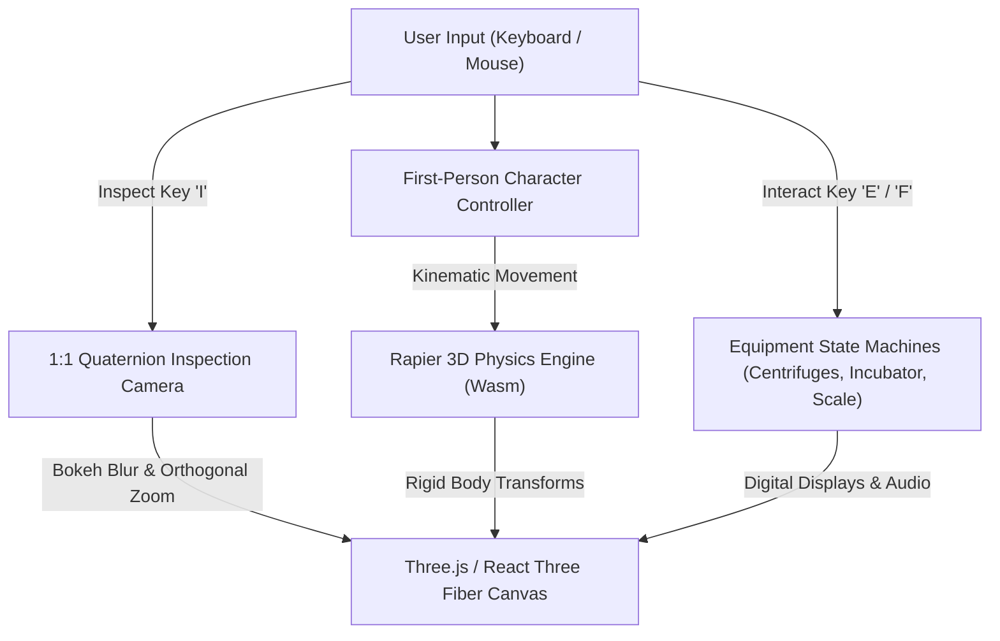
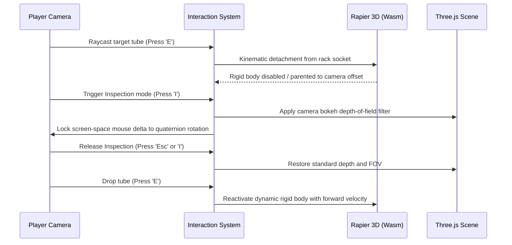

# Case Study 02: First-Person 3D WebGL Clinical Laboratory & Physics Simulation

## 1. Overview
This case study documents the design and implementation of an interactive 3D WebGL virtual laboratory simulation created for first-person training in clinical immunohematology protocols. Running entirely in modern desktop WebGL2 browsers without external streaming infrastructure or server dependencies, the application simulates physical biological test tube handling, clinical equipment operation (centrifuges, incubators, analytical precision scales), and real-time visual inspection of diagnostic reaction patterns.

## 2. Context and Problem
Hands-on laboratory training in pre-transfusion immunohematology involves significant reagent costs, specialized centrifuges and incubators, and strict biological safety protocols. Traditional digital e-learning solutions rely primarily on 2D point-and-click quizzes that fail to develop physical spatial memory, equipment handling discipline, and sequential protocol validation. The project solved this limitation by building a self-contained 3D simulation with deterministic rigid-body physics, tactile interaction, and accurate equipment finite-state machines.

## 3. My Contributions
- **Built the 1:1 Quaternion Inspection System:** Formulated screen-space aligned quaternion rotation for biological sample tubes and diagnostic cards, eliminating gimbal lock and rotational drift while applying real-time depth-of-field bokeh blur for reading minute agglutination patterns.
- **Implemented Dynamic Rigid Body Collision Mechanics:** Integrated Rapier 3D physics to govern tube placement, rack extraction, physical socket snapping, and floor collision while preventing collision tunneling when items are held in the user's hand.
- **Modeled Finite-State Machines for Clinical Equipment:** Programmed stateful digital displays, positional audio, and mechanical interlocks for specialized laboratory equipment:
  - *Dedicated Diagnostic Centrifuge & Incubator:* Programmable spin cycles, countdown timers, and lid locking mechanisms.
  - *Analytical Precision Scale:* Weight stabilization algorithms and tare mechanics.
  - *Storage Refrigerator:* Articulated door physics with positional audio feedback.
- **Automated E2E Performance Testing Suite:** Developed a Playwright test harness running headless Chromium in CI to measure frame rates and render time over continuous two-minute navigation routes.

## 4. Technical Architecture
The application runs as a modular Three.js / React Three Fiber scene, isolating deterministic physics calculations from visual rendering:

## 5. Technology Stack
- **Core 3D Engine:** Three.js, React Three Fiber (R3F), `@react-three/drei`.
- **Physics Engine:** `@react-three/rapier` (Rapier 3D compiled to WebAssembly).
- **Language & Runtime:** TypeScript (strict mode), Node.js, Vite.
- **Testing & QA:** Playwright (Chromium E2E headless & headed regression suite), Vitest.

## 6. Engineering Challenges
### 1. Rotational Drift and Gimbal Lock During Tube Inspection
*Problem:* In standard Euler angle implementations, rotating a 3D tube relative to the camera to read labels created severe gimbal lock and unnatural orientation flips when looking up or down.
*Solution:* Switched rotation logic entirely to quaternions mapped directly to screen-space coordinates. Mouse movements on the X and Y axes apply incremental rotations around the camera's local up and right vectors, resulting in drift-free, intuitive 1:1 tactile examination.

### 2. Player Collider Collisions with Held Objects
*Problem:* When a student picked up a test tube, the physics engine registered a collision between the player's character capsule collider and the held object's rigid body, launching the player across the room.
*Solution:* Dynamically transitioned picked-up items into kinematic sensor mode, stripping internal colliders while held and restoring dynamic rigid-body properties only upon intentional drop or socket placement.

## 7. Engineering Practices
- **Zero Remote Runtime Dependencies:** The build artifact is completely self-contained, loading all 3D assets, fonts, and WebAssembly binaries locally without requiring external CDNs.
- **Reproducible 3D Asset Conversion Pipeline:** Built an asset ingestion script that extracts raw FBX models, normalizes metric scale dimensions to real-world laboratory proportions (e.g., 34 cm clipboard), and preserves original UV channels.
- **Automated Performance Profiling:** Maintained an automated 120-second Playwright route monitoring FPS baselines to guard against memory leaks and CPU thread contention.

## 8. Results and Impact
- **21 verified commits** delivering the complete 3D laboratory environment, physics interaction, and clinical equipment.
- Flawless 60 FPS rendering in standard desktop browsers via WebGL2 and WebAssembly physics.
- High-fidelity pre-transfusion workflow implementation (tube labeling, blood bag inspection, gel card agglutination interpretation).

## 9. My Role
Sole Software Engineer and 3D Systems Architect. Responsible for the entire codebase: physics integration, interaction math, equipment state machines, asset conversion scripts, and automated E2E tests.
