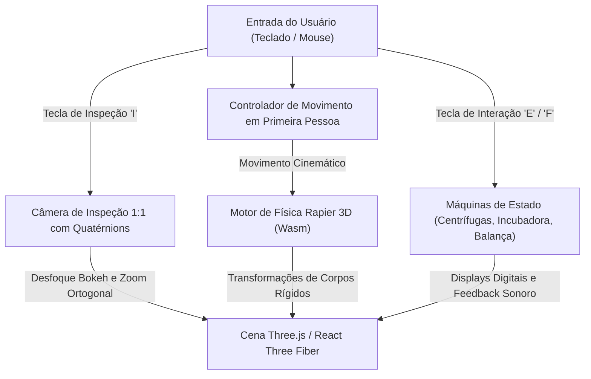
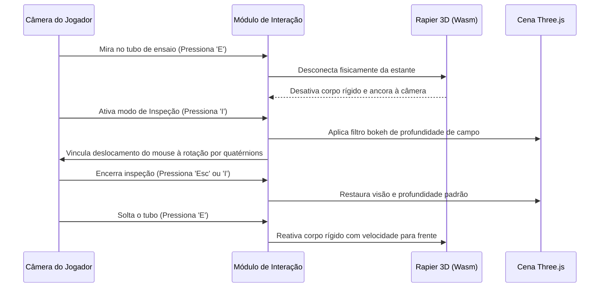

# Estudo de Caso 02: Laboratório Clínico Virtual 3D em WebGL com Simulação Física em Primeira Pessoa

  
  
  
  
  
  
  

## 1. Visão Geral
Este estudo de caso documenta o projeto e desenvolvimento de uma simulação de laboratório virtual 3D interativa em WebGL, concebida para treinamento em primeira pessoa em protocolos de imuno-hematologia laboratorial. Executada inteiramente no navegador via WebGL2 sem necessidade de servidores de streaming ou infraestrutura remota, a aplicação simula a manipulação física de tubos de ensaio, a operação de instrumentos analíticos (centrífugas, incubadoras e balanças de precisão) e a análise visual em tempo real de reações de aglutinação.

## 2. Contexto e Problema
A capacitação prática em rotinas pré-transfusionais envolve custos recorrentes com reagentes biológicos, disponibilidade de equipamentos específicos e respeito a protocolos estritos de biossegurança. Softwares educacionais tradicionais costumam se limitar a questionários 2D de clicar e arrastar, formato que não estimula a percepção espacial, a familiaridade motora com o maquinário nem a validação de sequências procedimentais. O projeto contornou essa barreira construindo uma simulação tridimensional com física determinística de corpos rígidos, interação tátil e máquinas de estado para cada equipamento.

## 3. Minhas Contribuições
- **Desenvolvimento do Sistema de Inspeção 1:1 com Quatérnions:** Formulei rotações com quatérnions alinhadas à orientação da câmera para tubos de amostra e cartões de gel, eliminando o travamento de cardan (gimbal lock) e derivas de rotação, além de aplicar desfoque de profundidade de campo bokeh para leitura detalhada de aglutinações.
- **Mecânica de Colisão de Corpos Rígidos:** Integrei o motor de física Rapier 3D para coordenar o encaixe de tubos em estantes, retirada de frascos, posicionamento em suportes e colisões com o cenário, evitando travamentos ou transposição indevida de superfícies quando os itens estão nas mãos do usuário.
- **Modelagem de Máquinas de Estado para Equipamentos Clínicos:** Programei mostradores digitais interativos, efeitos sonoros posicionais e travas mecânicas para o maquinário laboratorial:
  - *Centrífuga e Incubadora de Diagnóstico:* Ciclos de rotação temporizados, contagem regressiva e travamento da tampa durante o funcionamento.
  - *Balança Analítica de Precisão:* Algoritmos de estabilização de peso e função de tara.
  - *Refrigerador de Conservação:* Física articulada na porta com retorno sonoro de abertura e fechamento.
- **Bateria de Testes Automatizados de Desempenho:** Estruturei rotinas no Playwright executando Chromium em modo headless na esteira de integração contínua para monitorar taxa de quadros e estabilidade de renderização durante percursos de teste contínuos de dois minutos.

## 4. Arquitetura Técnica
A aplicação opera como uma cena modular em Three.js e React Three Fiber, separando cálculos físicos determinísticos da renderização visual:

## 5. Stack Tecnológica
- **Motor 3D Principal:** Three.js, React Three Fiber (R3F), `@react-three/drei`.
- **Motor de Física:** `@react-three/rapier` (Rapier 3D compilado para WebAssembly).
- **Linguagem e Ambiente:** TypeScript (modo estrito), Node.js, Vite.
- **Testes e Qualidade:** Playwright (testes automatizados de regressão em Chromium), Vitest.

## 6. Desafios de Engenharia
### 1. Travamento de Cardan e Desvios na Inspeção de Amostras
*Problema:* Rotações baseadas em ângulos de Euler faziam o frasco girar de maneira brusca ou inverter a orientação ao olhar para cima ou para baixo, impossibilitando a leitura correta das etiquetas.
*Solução:* Adotei quaternions calculados com base nas coordenadas da tela. O movimento do cursor do mouse nos eixos X e Y aplica variações incrementais sobre os vetores locais da câmera, garantindo rotação tátil, intuitiva e sem desvios angulares.

### 2. Conflito de Colisão entre o Personagem e os Itens Segurados
*Problema:* Ao pegar um frasco, o motor de física registrava colisão entre a cápsula de colisão do próprio jogador e o corpo rígido do tubo, arremessando o usuário pela sala.
*Solução:* Configurei os itens recolhidos para alternar temporariamente para modo de sensor cinemático, desativando colisões internas enquanto estiverem nas mãos do usuário e reativando as propriedades dinâmicas apenas no momento da soltura ou encaixe.

## 7. Práticas de Engenharia
- **Zero Dependências Remotas na Execução:** O pacote gerado é completamente autônomo, carregando todos os modelos 3D, fontes e binários WebAssembly localmente sem consultar CDNs externos.
- **Esteira de Conversão de Recursos 3D:** Criação de scripts para extrair arquivos FBX brutos, calibrar proporções métricas para medidas reais de laboratório (como prancheta com 34 cm) e manter os canais de textura originais.
- **Avaliação Contínua de Desempenho:** Teste automatizado de 120 segundos no Playwright monitorando os quadros por segundo para prevenir vazamentos de memória e sobrecarga da CPU.

## 8. Resultados e Impacto
- **21 commits verificados** cobrindo todo o ambiente do laboratório 3D, física interativa e equipamentos de bancada.
- Renderização fluida a 60 FPS em navegadores comuns por meio de WebGL2 e WebAssembly.
- Simulação detalhada dos passos pré-transfusionais (etiquetagem de tubos, checagem de bolsas de sangue e leitura de aglutinação em cartões de gel).

## 9. Meu Papel
Engenheiro de Software e Arquiteto de Sistemas 3D Único. Responsável por todo o código: física, matemática de interação, máquinas de estado de maquinário, scripts de conversão de arquivos e testes automatizados de ponta a ponta.
