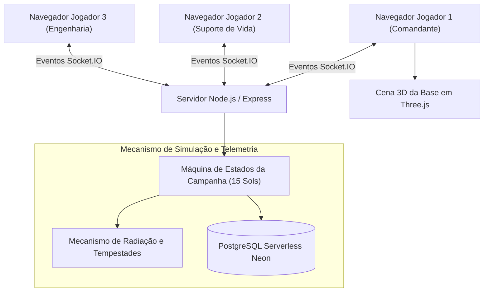
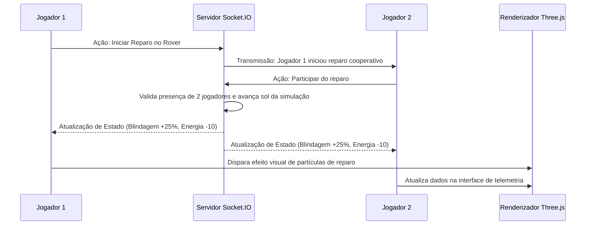

# Estudo de Caso 12: Motor de Simulação Espacial Cooperativa Multiusuário em Tempo Real

## 1. Visão Geral
Este estudo de caso analisa o desenvolvimento de um motor de simulação cooperativa multiusuário em tempo real com temática de exploração espacial. Criada no contexto de um hackathon internacional de tecnologia e espaço, a aplicação web viabiliza que equipes de 1 a 4 pessoas administrem juntas o suporte de vida, as reservas energéticas e incursões de superfície em uma base simulada.

## 2. Contexto e Problema
A coordenação de jogos cooperativos em tempo real diretamente no navegador exige manter os estados perfeitamente sincronizados entre jogadores em conexões com latências variadas. Paralelamente, simulações espaciais requerem traduzir regras científicas complexas (como tempestades de radiação solar, ciclos de captação de energia e atenuação atmosférica) em dinâmicas intuitivas que preservem o engajamento sem sobrecarregar o usuário.

## 3. Minhas Contribuições
- **Desenvolvimento da Sequência de Lançamento e Pouso Planetário:** Projetei e programei a cena interativa do foguete com identidade visual do evento, efeitos de partículas com shaders, controles interativos e áudio posicional sincronizado para a descida na superfície.
- **Implementação do Mecanismo de Blindagem contra Radiação:** Criei o subsistema de defesa da base, calibrando os episódios de tempestades solares com dados científicos reais de telemetria de radiação do espaço profundo.
- **Criação de Minijogos de Reparo Cooperativo:** Programei tarefas sincronizadas que exigem ação simultânea de dois jogadores para conclusão (como reparos no veículo de exploração e ajuste de antenas de rádio).
- **Refatoração para Arquitetura com Autoridade no Servidor:** Iniciei a migração das regras de transição de estado da máquina de jogo do cliente local para manipuladores centralizados via Socket.IO para mitigar divergências de sincronização entre os participantes.

## 4. Arquitetura Técnica
A aplicação sincroniza eventos via WebSockets ao mesmo tempo em que processa a cena 3D localmente:

## 5. Stack Tecnológica
- **Frontend:** React 19, TypeScript, Vite, React Router, Zustand, Three.js.
- **Comunicação em Tempo Real:** Socket.IO (WebSockets com fallback para polling).
- **Backend e Persistência:** Node.js, Express, Neon PostgreSQL, Drizzle ORM.
- **Áudio e Mídia:** Web Audio API, sintetizadores de áudio procedural.

## 6. Desafios de Engenharia
### 1. Sincronização de Trilha Sonora e Cenas Cinematográficas
*Problema:* Na transição entre o lançamento e o pouso, variações no tempo de carregamento de recursos nos computadores dos participantes descompassavam a música e as animações de câmera.
*Solução:* Desenvolvi uma rotina de pré-carregamento sincronizada que baixa a geometria 3D e os buffers de áudio em paralelo durante a contagem regressiva da viagem, liberando a cena de chegada simultaneamente para todos os navegadores conectados.

### 2. Conversão de Dados Científicos de Radiação em Regras de Sobrevivência
*Problema:* Registros científicos brutos de radiação contêm variações muito específicas que resultavam em regras confusas se aplicadas diretamente à mecânica de jogo.
*Solução:* Formulei um modelo simplificado que transforma leituras reais de sensores em milisieverts em níveis graduais de alerta, associando a integridade da blindagem diretamente ao decaimento dos geradores de oxigênio da base.

## 7. Práticas de Engenharia
- **Tipagens Compartilhadas em Monorepo:** Organização com npm workspaces mantendo as interfaces de eventos de rede sincronizadas entre as pastas do servidor e do cliente.
- **Tratamento de Bloqueios de Rede:** Suporte a chaveamento automático de WebSockets para requisições HTTP do tipo long-polling em redes corporativas com filtros rígidos.
- **Acessibilidade em Avisos de Emergência:** Indicadores luminosos na tela acompanham todos os avisos sonoros para garantir a jogabilidade de participantes com deficiência auditiva.

## 8. Resultados e Impacto
- **12 commits verificados** englobando a tela interativa de lançamento, sistemas de blindagem, tarefas de reparo e lógica de rede.
- Execução estável de sessões cooperativas com até 4 participantes simultâneos diretamente pelo navegador.
- Integração harmoniosa entre dados científicos públicos e dinâmicas interativas de simulação.

## 9. Meu Papel
Desenvolvedor de Frontend e Simulação em equipe de três integrantes. Liderei a reformulação da cena de lançamento, mecânicas de blindagem, minijogos de reparo e ganchos de sincronização com o servidor.
