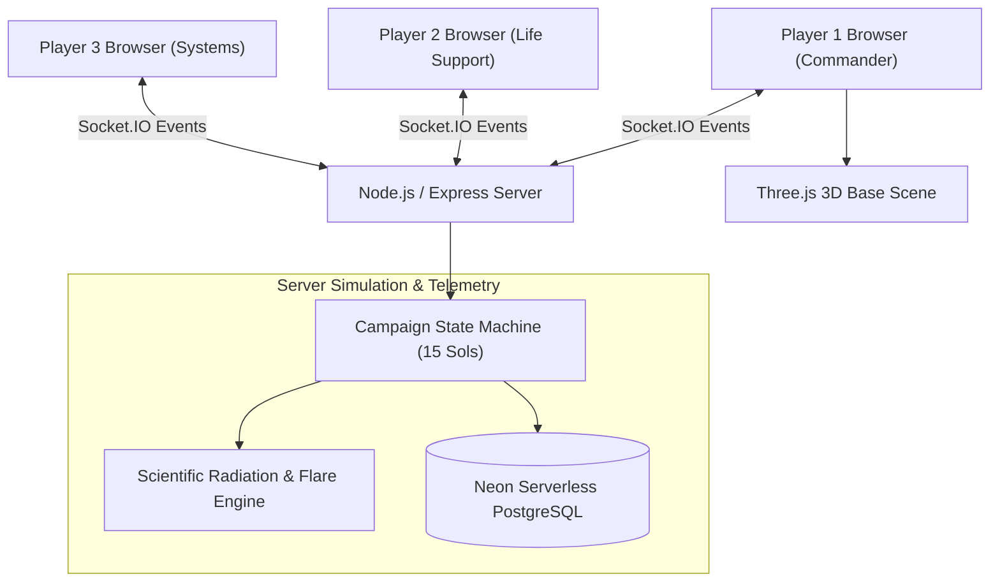
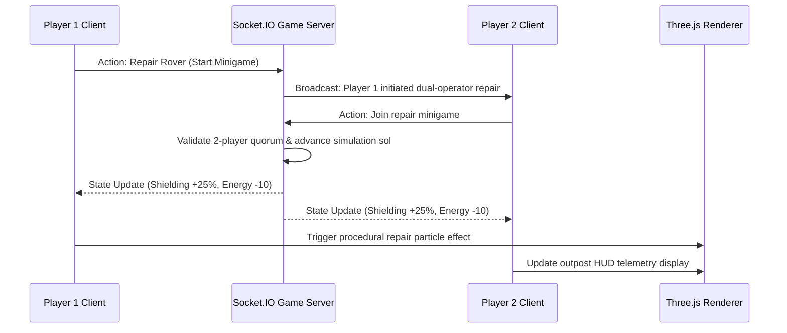

# Case Study 12: Multi-User Real-Time Simulation Engine & Space Flight Telemetry

## 1. Overview
This case study examines the development of a real-time, cooperative multi-user space exploration simulation engine. Developed for an international space applications hackathon, the browser-based application allows 1 to 4 players to cooperatively manage life-support systems, energy balances, and surface exploration missions on a simulated planetary outpost.

## 2. Context and Problem
Building real-time cooperative multiplayer simulations directly inside web browsers involves synchronizing game states across heterogeneous network conditions without perceptible latency. Furthermore, space survival simulations require integrating complex scientific constraints (solar radiation flares, diurnal power fluctuations, atmospheric attenuation) into intuitive game mechanics without overwhelming non-technical players.

## 3. My Contributions
- **Engineered Interactive 3D Launch and Planetary Arrival Sequences:** Redesigned and implemented the interactive rocket launch scene with Space Apps branding, custom particle shaders, interactive launch controls, and synchronized planetary landing audio cues.
- **Developed Dynamic Planetary Shielding Mechanics:** Designed and implemented the outpost's radiation shielding subsystem, calibrating radiation hazard events against real-world deep-space radiation telemetry data.
- **Built Multi-User Cooperative Repair Minigames:** Implemented synchronized cooperative minigames requiring multi-player coordination (e.g., surface vehicle repairs, communications antenna alignment).
- **Refactored Campaign Simulation to Server-Authoritative Architecture:** Began transitioning state transition loops from local client state into server-authoritative Socket.IO event handlers to prevent client desynchronization.

## 4. Technical Architecture
The application coordinates state across WebSockets while maintaining client-side 3D rendering:

## 5. Technology Stack
- **Frontend:** React 19, TypeScript, Vite, React Router, Zustand, Three.js.
- **Networking & Real-Time:** Socket.IO (WebSockets / Fallback Polling).
- **Backend & Persistence:** Node.js, Express, Neon PostgreSQL, Drizzle ORM.
- **Audio & Media:** Web Audio API, procedural sound synthesizers.

## 6. Engineering Challenges
### 1. Synchronizing Multi-User Audio and Cinematic State Transitions
*Problem:* In early builds, when players transitioned from the Earth launch phase to planetary arrival, disparate network loading times caused audio cues and visual cameras to desynchronize between team members.
*Solution:* Built a synchronized preloading sequence that loads 3D geometry and audio buffers in parallel during the simulated transit sol, ensuring all connected clients emit simultaneous arrival triggers upon world readiness.

### 2. Modeling Realistic Radiation Hazards Without Disrupting Gameplay Flow
*Problem:* Raw scientific radiation telemetry datasets feature complex variations that were difficult to translate into intuitive survival game rules.
*Solution:* Developed a normalized radiation exposure model that translates scientific millisievert sensor readings into clear visual warning tiers, mapping planetary magnetosphere shielding levels directly to life-support degradation curves.

## 7. Engineering Practices
- **Strict Monorepo Dependency Hygiene:** Configured npm workspaces keeping shared protocol types synchronized across server and client packages.
- **Defensive Networking Fallbacks:** Supported automatic fallback from raw WebSockets to long-polling HTTP when operating under restrictive institutional proxy firewalls.
- **Accessible Audio and Visual Feedback:** Built visual indicators for hearing-impaired users to accompany all critical audible warning alerts.

## 8. Results and Impact
- **12 verified commits** delivering the interactive launch screen, radiation shielding systems, vehicle repair minigames, and campaign server logic.
- Successful deployment of a multiplayer browser simulation supporting 4-player cooperative sessions.
- Seamless integration of curated scientific space datasets into interactive web gaming mechanics.

## 9. My Role
Core Frontend and Simulation Developer in a 3-person hackathon team. Owned the launch scene redesign, planetary shielding mechanics, interactive repair minigames, and client-server synchronization hooks.
