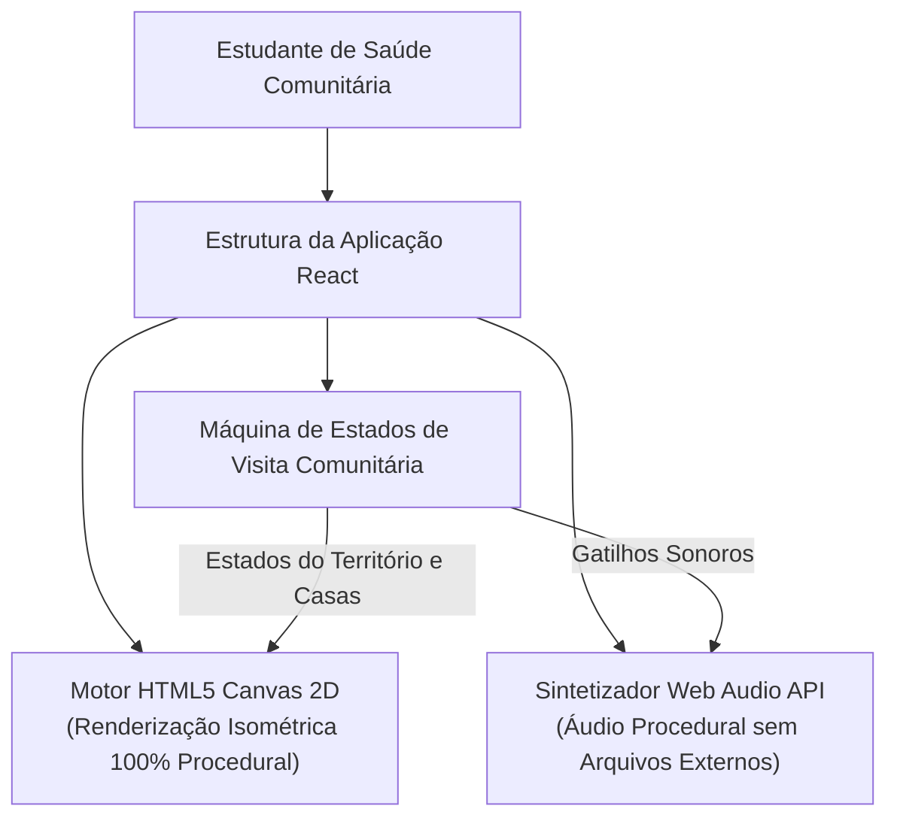
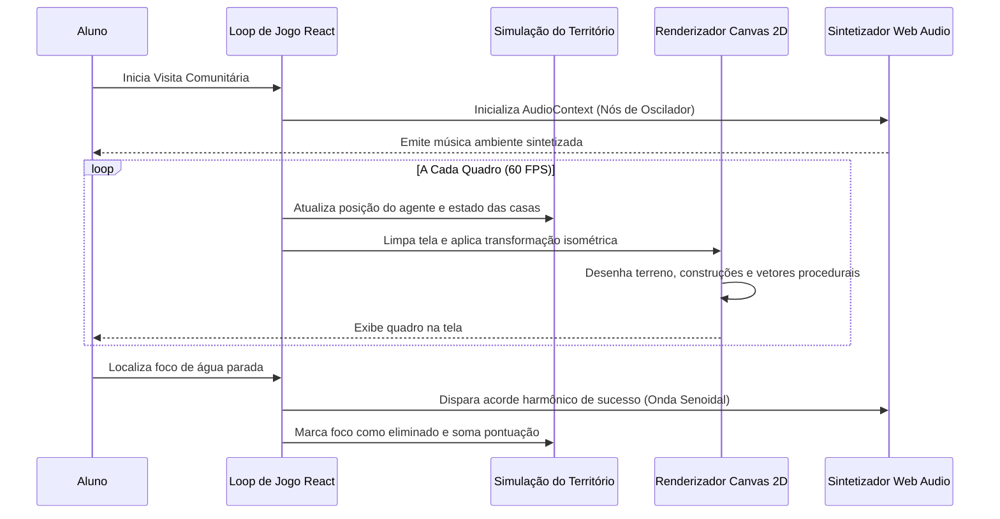

# Estudo de Caso 14: Simulação Educacional Isométrica 2D sem Dependência de Imagens Externas

## 1. Visão Geral
Este estudo de caso documenta o projeto e desenvolvimento de um jogo educacional 2D com perspectiva isométrica, criado para treinamento de agentes comunitários de saúde na Atenção Primária. Executada unicamente com tecnologias nativas do navegador (React e HTML5 Canvas 2D), a simulação desenha 100% de seus elementos visuais, personagens e cenários de forma procedural via código, acompanhada por trilha sonora sintetizada em tempo real pela Web Audio API.

## 2. Contexto e Problema
Aplicações educacionais para a área da saúde frequentemente exigem conexões de alta velocidade devido ao tamanho de pacotes de imagens, amostras gravadas de áudio e texturas, inviabilizando o acesso em áreas periféricas ou rurais com sinal restrito de internet móvel. Além disso, questionários teóricos de múltipla escolha não desenvolvem a habilidade dos agentes de identificar riscos sanitários no território (como focos de água parada, descarte irregular de resíduos e distribuição das residências).

## 3. Minhas Contribuições
- **Estruturação da Base do Projeto:** Inicializei o projeto estabelecendo a arquitetura modular que separa o estado da partida, as árvores de diálogo, as tarefas de inspeção e os loops de desenho na tela.
- **Desenvolvimento da Leitura Interativa do Território:** Substituí questões teóricas estáticas de múltipla escolha (`Troca intro-03 de múltipla escolha por leitura do território`) por uma mecânica interativa onde o aluno navega pelas microáreas, inspeciona os quintais e localiza potenciais criadouros de vetores.
- **Renderização Isométrica com Canvas 2D:** Modelei a projeção matemática isométrica no Canvas, convertendo coordenadas de grade plana em losangos no espaço da tela com ordenação dinâmica de sobreposição (depth sorting).
- **Geração de Áudio com Síntese em Tempo Real:** Conectei nós de osciladores e controle de ganho na Web Audio API para tocar melodias e efeitos sonoros sem carregar arquivos MP3 ou WAV.

## 4. Arquitetura Técnica
A aplicação funciona como um ciclo autônomo de renderização no próprio navegador do usuário:

## 5. Stack Tecnológica
- **Framework e Linguagem:** JavaScript, React, Vite.
- **Motor Gráfico:** API HTML5 Canvas 2D (projeção isométrica calculada matematicamente).
- **Motor de Áudio:** Web Audio API (síntese via osciladores e geradores de envelope).
- **Construção e Qualidade:** Vite, ESLint.

## 6. Desafios de Engenharia
### 1. Eliminação Total do Download de Imagens e Sons
*Problema:* Baixar conjuntos de imagens e sons em conexões móveis lentas em postos de saúde gerava longos períodos de espera e abandono do treinamento.
*Solução:* Programei algoritmos geométricos para desenhar casas, telhados, cercas e personagens utilizando apenas traçados nativos do Canvas (`beginPath`, `lineTo`, `arc`, `fill`). Com o uso exclusivo de fórmulas matemáticas e gradientes de cores, o tamanho de transferência de arquivos de mídia caiu para zero bytes.

### 2. Ordenação Dinâmica de Profundidade em Perspectiva Isométrica
*Problema:* Em projeções isométricas, os elementos precisam ser desenhados na ordem exata do fundo para a frente; caso contrário, os personagens atravessam paredes ou caminham por baixo do chão.
*Solução:* Implementei uma ordenação periódica de profundidade que organiza todas as entidades a serem desenhadas pela soma de suas coordenadas isométricas `(x + y)` antes de renderizar cada quadro, eliminando falhas visuais de sobreposição.

## 7. Práticas de Engenharia
- **Portabilidade Máxima:** A compilação gera um diretório estático minúsculo (`dist/`) capaz de rodar sem conexão em armazenamentos locais ou em servidores web simples.
- **Aprendizado Prático por Exploração:** Planejamento de interações que ensinam a identificar barreiras sanitárias através da exploração ativa do cenário, em vez de memorização mecânica de texto.
- **Componentização Extensível:** Separação de módulos específicos (`DengueHuntMission`, `TerritoryObserveGame`, `BloodGlucoseRender`) facilitando a inclusão de novas atividades de triagem clínica.

## 8. Resultados e Impacto
- **2 commits verificados** estabelecendo a base da arquitetura e desenvolvendo a navegação e leitura do território.
- Aplicação funcional de simulação em saúde sem arquivos externos de mídia, com abertura instantânea em qualquer celular ou computador.
- Capacitação imersiva de agentes comunitários sem custos de transferência de dados gráficos.

## 9. Meu Papel
Desenvolvedor Fundador e Arquiteto de Simulação. Estruturei a fundação do código, concebi a exploração territorial interativa e organizei o ciclo de renderização no Canvas.
