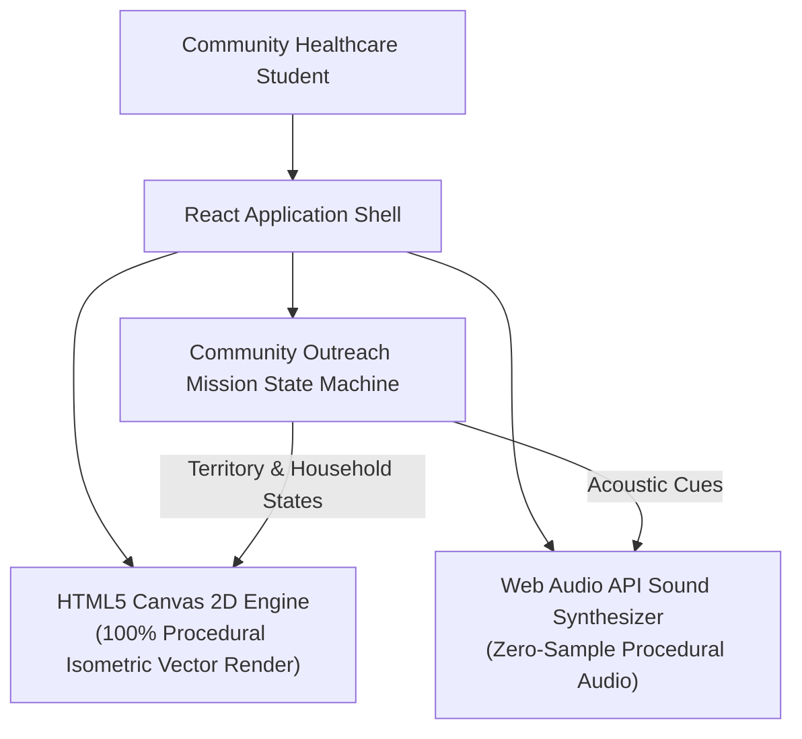
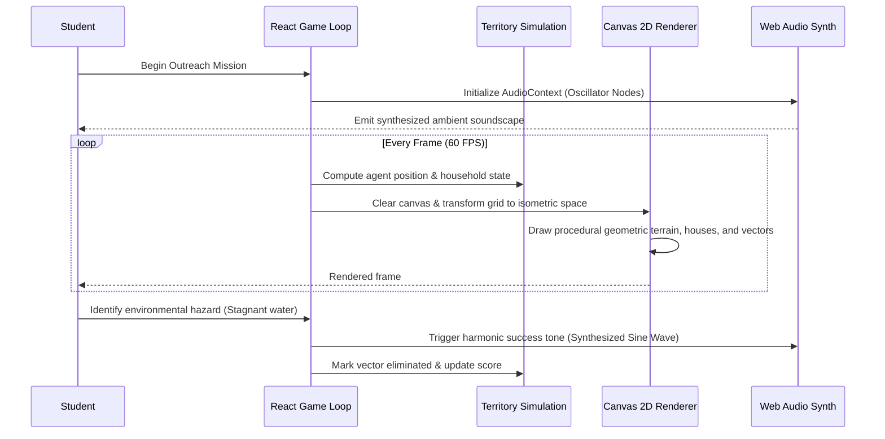

# Case Study 14: Zero-Asset Procedural 2D Isometric Healthcare Training Simulation

## 1. Overview
This case study documents the design and development of an educational 2D simulation game featuring an isometric perspective, built to train primary healthcare community agents. Running entirely on client-side web technologies (React and Vanilla HTML5 Canvas 2D), the simulation generates 100% of its visual assets, character sprites, and environments procedurally in code without external image files, paired with background music synthesized in real time via the Web Audio API.

## 2. Context and Problem
Healthcare educational web tools frequently suffer from heavy network footprints caused by large image sprite sheets, audio soundbanks, and 3D textures, making them inaccessible over poor mobile internet connections in remote rural areas. Furthermore, standard multiple-choice quiz formats fail to engage community health agents in reading spatial and environmental health cues (e.g., stagnant water containers, vector breeding zones, vulnerable household distributions).

## 3. My Contributions
- **Created the Core Project Architecture:** Initialized the project foundation and established the modular component structure separating game state, dialogues, minigames, and rendering loops.
- **Engineered Interactive Territory Exploration Mechanics:** Replaced legacy multiple-choice questions (`Troca intro-03 de múltipla escolha por leitura do território`) with an interactive territory reading mechanic requiring players to spatially navigate microareas, examine residential plots, and identify environmental vectors.
- **Integrated Procedural Isometric Canvas Rendering:** Structured the Canvas 2D isometric projection pipeline, transforming 2D grid coordinates into screen-space isometric diamonds with dynamic depth sorting.
- **Implemented Web Audio Synthesis Pipelines:** Integrated procedural audio oscillators and gain nodes to generate ambient acoustic feedback and musical motifs without loading recorded MP3 or WAV assets.

## 4. Technical Architecture
The application runs as a lightweight, self-contained client-side rendering loop:

## 5. Technology Stack
- **Framework & Language:** JavaScript, React, Vite.
- **Graphics Engine:** HTML5 Canvas 2D API (Procedural isometric projection).
- **Audio Engine:** Web Audio API (Synthesized oscillators and envelope generators).
- **Build & Quality:** Vite, ESLint.

## 6. Engineering Challenges
### 1. Achieving Zero-Asset Visual Quality
*Problem:* Downloading sprite packs over low-bandwidth cellular networks in remote health clinics caused long load times and high bounce rates.
*Solution:* Formulated geometric vector algorithms to draw all buildings, roofs, fences, and character sprites directly using Canvas path commands (`beginPath`, `lineTo`, `arc`, `fill`). By relying on pure math and color gradients, the total asset transfer size was reduced to zero bytes.

### 2. Real-Time Dynamic Isometric Depth Sorting
*Problem:* In isometric projections, characters and environmental objects must be rendered in strict back-to-front order; otherwise, characters incorrectly clip through building walls or walk underneath ground tiles.
*Solution:* Implemented an active depth-sorting buffer that orders all drawable entities by their composite isometric depth coordinates `(x + y)` before executing each frame's draw pass, eliminating visual z-fighting.

## 7. Engineering Practices
- **Extreme Portability:** The application builds into a minuscule, static `dist/` bundle that can run completely offline from local storage or low-cost static web servers.
- **Accessible Learning Mechanics:** Designed spatial interaction patterns that teach real-world sanitary barrier identification through direct exploration rather than passive text memorization.
- **Standardized Component Hierarchy:** Structured modular subcomponents (`DengueHuntMission`, `TerritoryObserveGame`, `BloodGlucoseRender`) to allow rapid extension of new clinical triage modules.

## 8. Results and Impact
- **2 verified commits** laying the architectural foundation and implementing the spatial territory exploration mechanics.
- A fully functional, zero-external-asset educational healthcare simulation that loads instantaneously on any mobile or desktop browser.
- Interactive vector identification training without requiring heavy graphic asset downloads.

## 9. My Role
Founding Developer and Simulation Architect. Established the project foundation, designed the isometric territory exploration mechanics, and structured the procedural Canvas game loop.
