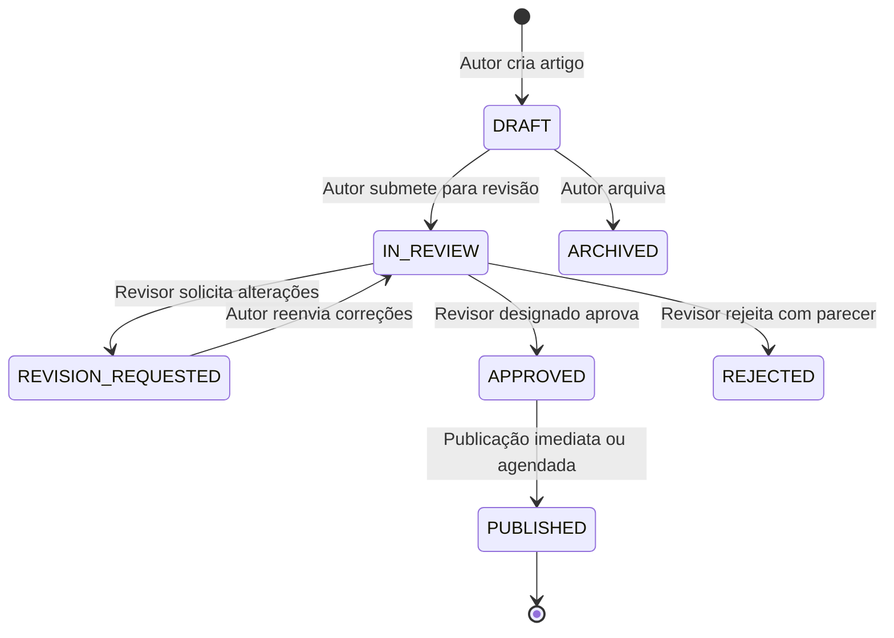
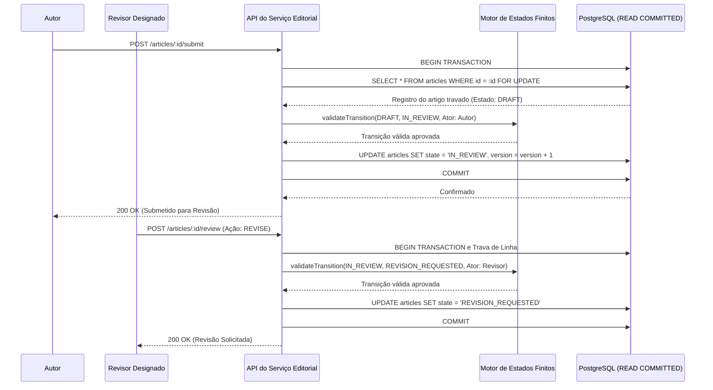

# Estudo de Caso 09: Motor de Fluxo Editorial Concorrente com Máquinas de Estado Formais

## 1. Visão Geral
Este estudo de caso documenta o projeto e desenvolvimento de um microsserviço editorial orientado a eventos responsável por governar o ciclo de vida de publicações técnicas: da redação inicial e colaboração entre autores até a revisão de tutores regionais, ajustes formais e publicação definitiva. Construído com Node.js e PostgreSQL, o serviço adota uma máquina de estados finitos (FSM) apoiada por controles de concorrência transacionais para coordenar fluxos com múltiplos participantes.

## 2. Contexto e Problema
Fluxos de divulgação científica e relatórios institucionais exigem rigorosas etapas editoriais: autores escrevem o conteúdo, revisores designados avaliam e apontam ajustes, e coordenadores autorizam a publicação. Sem uma validação formal de estados e travas de concorrência, revisões simultâneas de múltiplos participantes ou envios concorrentes causavam inconsistências no banco de dados (como artigos publicados sem aprovação formal) e distorções de autoria.

## 3. Minhas Contribuições
- **Desenvolvimento do Motor de Máquina de Estados:** Programei uma máquina de estados determinística que valida os caminhos de transição permitidos, bloqueando desvios fora da ordem definida (como transitar de `DRAFT` direto para `PUBLISHED`).
- **Travamento Atômico em Banco sob READ COMMITTED:** Estruturei toda a lógica de transição dentro de transações PostgreSQL utilizando travas em nível de linha (`SELECT FOR UPDATE`), eliminando condições de corrida entre aprovações simultâneas de tutores ou envios de autores.
- **Aplicação de Testes de Mutação nas Regras Editoriais:** Submeti o mecanismo de autorização e as transições da máquina de estados a testes de mutação para garantir a integridade dos limites de acesso de cada papel.
- **Modelagem de Envios com Histórico Imutável:** Modelei um esquema de versões imutáveis onde cada ciclo de revisão registra uma versão isolada, preservando os pareceres e as diferenças de texto ao longo do tempo.
- **Comunicação Desacoplada com o Serviço de Identidade:** Construí um cliente de autenticação que valida papéis e vínculos de grupos junto ao serviço de IAM sem expor credenciais internas.

## 4. Arquitetura Técnica
O serviço isola as transições de estado dentro de transações protegidas por travas no banco:

## 5. Stack Tecnológica
- **Backend e API:** Node.js, Express.js, TypeScript.
- **Persistência de Dados:** PostgreSQL (travas de linha atômicas e isolamento de transação `READ COMMITTED`).
- **Padrões de Arquitetura:** Máquina de Estados Finitos (FSM), segregação simplificada de leitura e escrita (CQRS light).
- **Testes e Qualidade:** Jest, Testes de Mutação, Vitest.

## 6. Desafios de Engenharia
### 1. Inconsistências de Concorrência Durante Ações Simultâneas de Revisão
*Problema:* Em grupos com múltiplos revisores avaliando o mesmo artigo, decisões simultâneas de "Aprovar" e "Solicitar Ajustes" causavam condições de corrida, deixando o artigo aprovado enquanto gerava notificações de solicitação de mudanças.
*Solução:* Englobei a validação e a mudança de estado em uma transação com trava de linha (`SELECT FOR UPDATE`). A primeira requisição atualiza o estado e a versão do artigo; a segunda transação falha na validação contra o novo estado e retorna de forma segura um erro HTTP 409 Conflict.

### 2. Controle Estrito de Permissões por Papel e Grupo
*Problema:* Revisores só podiam aprovar trabalhos de autores pertencentes ao seu próprio grupo de trabalho, enquanto administradores gerais gerenciavam o sistema sem atuar diretamente como coautores.
*Solução:* Criei regras de validação separando expressamente os papéis (Admin, Revisor, Autor) e adicionei testes de mutação para demonstrar matematicamente que nenhum usuário consegue acionar transições não permitidas.

## 7. Práticas de Engenharia
- **Snapshots Imutáveis de Revisão:** Cada rodada de parecer salva uma cópia imutável do conteúdo, impedindo que o autor altere o texto enquanto uma revisão formal estiver em andamento.
- **Validação com Testes de Mutação:** Toda a matriz de transição de estados é coberta por testes de mutação, assegurando proteção contra falhas causadas por operadores condicionais.
- **Erros Semânticos Claros:** Substituição de falhas silenciosas por exceções de domínio mapeadas diretamente para códigos HTTP semânticos (400, 403, 409, 422).

## 8. Resultados e Impacto
- **13 commits verificados** implementando a máquina de estados, travas transacionais, testes de mutação e pipelines de revisão.
- Eliminação total de corrupção de estados em avaliações editoriais concorrentes.
- Operação estável na gestão de relatórios técnicos entre equipes regionais descentralizadas.

## 9. Meu Papel
Arquiteto e Desenvolvedor Backend Único do Serviço Editorial. Projetei a máquina de estados finitos, as travas transacionais em banco de dados, os testes de mutação e o cliente de integração com o serviço de autenticação.
