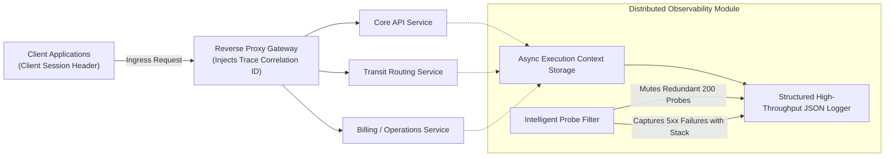
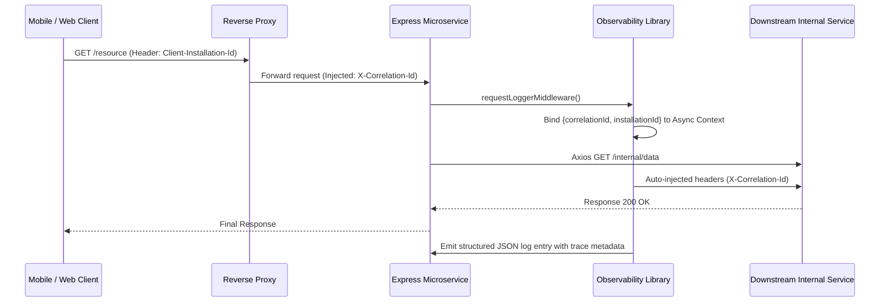

# Case Study 03: High-Throughput Node.js Distributed Tracing & Structured Logging Library

## 1. Overview
This case study details the architecture and implementation of an in-house distributed tracing, correlation context propagation, and structured telemetry library (`observability-lib`) for Node.js microservices. Designed as a zero-dependency core module distributed across internal repositories, the library standardizes log formatting, error reporting, and container health probe handling across decoupled services.

## 2. Context and Problem
Modern multi-service architectures handling mobile client interactions, asynchronous background workers, and administrative operations frequently suffer from observability fragmentation. Disparate services generate unstructured logs with inconsistent timestamps, lack end-to-end trace correlation across HTTP boundaries, and lose diagnostic context during asynchronous event loops. In addition, high-frequency container health probes flood log aggregation pipelines with redundant successful checks, masking legitimate error signals.

## 3. My Contributions
- **Created the Core Observability Engine:** Designed the library from scratch, packaging it for distribution across internal repositories with clean TypeScript definitions and zero extraneous runtime dependencies.
- **Implemented Distributed Correlation Propagation:** Authored Express middlewares and Axios HTTP interceptors that automatically capture, generate, and forward trace correlation headers and client session identifiers across microservice hops.
- **Engineered Noise-Suppression Health Logging:** Programmed a custom request logging middleware that mutes noisy 200 OK responses from container orchestrator `/health` and `/metrics` pollers, while ensuring any degraded or failed health check is immediately logged at ERROR level with complete diagnostic payloads.
- **Built Background Task Context Tracking:** Developed execution wrappers (`background helpers`) that preserve trace contexts across asynchronous task queues, timers, and background workers.

## 4. Technical Architecture
The library uses Node.js asynchronous execution tracking and structured streaming with Pino:

## 5. Technology Stack
- **Language & Runtime:** TypeScript (strict typing), Node.js.
- **Logging & Serialization:** Pino (high-throughput JSON structured logger).
- **HTTP Instrumentation:** Axios interceptors, Express middleware, Node.js AsyncLocalStorage.
- **Integration:** Git-based package distribution.

## 6. Engineering Challenges
### 1. Context Bleed and Lost Trace IDs in Asynchronous Callbacks
*Problem:* In asynchronous event loops involving timers, background database updates, and external API calls, correlation IDs were frequently lost or mingled between concurrent sessions.
*Solution:* Leveraged Node.js execution context storage (`AsyncLocalStorage`) to maintain an immutable correlation context boundary per request lifecycle, ensuring every nested log entry inherits the original correlation identifier without manual parameter passing.

### 2. Log Ingestion Overload from Frequent Health Probes
*Problem:* Automated container health check probes hit microservice endpoints every few seconds, generating thousands of useless log lines per hour that consumed storage quota and obscured genuine runtime errors.
*Solution:* Implemented conditional middleware filtering that inspects both the route path and the resulting status code. Successful 200 probes are silently passed through, but non-200 responses immediately trigger an error log with detailed system diagnostic info.

## 7. Engineering Practices
- **Strict Semantic Versioning:** Managed orderly version increments accompanied by markdown documentation detailing integration patterns.
- **Minimal Footprint:** Designed with zero bloat to avoid adding execution overhead to microservice latency budgets.
- **Standardized Log Schemas:** Guaranteed that all output matches an exact JSON schema containing ISO-8601 timestamps, log level, service name, correlation ID, installation ID, HTTP method, path, and duration.

## 8. Results and Impact
- **19 verified commits** establishing the library, context interceptors, and releases up to version 1.4.0.
- Standardized logging across 5 backend microservices and the administrative web portal.
- Substantial reduction in log volume through intelligent health-check filtering, cutting noise while preserving 100% of failure diagnostics.

## 9. My Role
Sole Author and Maintainer of the library, responsible for API design, context propagation logic, middleware implementations, documentation, and versioning.
