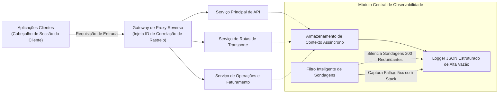
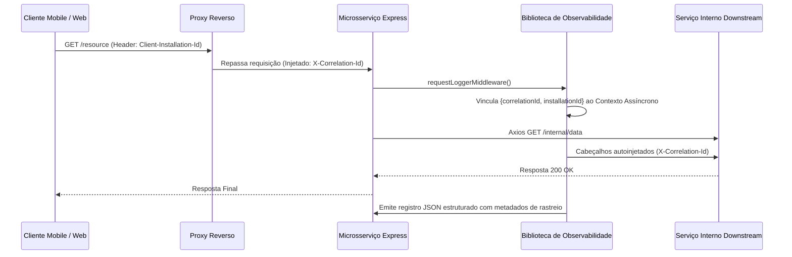

# Estudo de Caso 03: Biblioteca de Rastreamento Distribuído e Logs Estruturados para Node.js

## 1. Visão Geral
Este estudo de caso detalha a arquitetura e implementação de uma biblioteca interna de rastreamento distribuído, propagação de contexto de correlação e telemetria estruturada (`observability-lib`) para microsserviços Node.js. Projetada como um módulo central com zero dependências externas extras e distribuída entre repositórios internos, a biblioteca padroniza a formatação de logs, o tratamento de erros e as sondagens de saúde de contêineres em serviços desacoplados.

## 2. Contexto e Problema
Arquiteturas modernas com múltiplos serviços lidando com clientes móveis, tarefas assíncronas em segundo plano e operações administrativas frequentemente sofrem com a fragmentação da observabilidade. Serviços distintos geram logs não estruturados com carimbos de data/hora inconsistentes, perdem a correlação de ponta a ponta através de chamadas HTTP e perdem o contexto de diagnóstico durante o ciclo de eventos assíncronos. Além disso, verificações frequentes de saúde disparadas por orquestradores de contêineres inundam os registros com respostas 200 OK repetitivas, ocultando sinais legítimos de erro.

## 3. Minhas Contribuições
- **Criação do Núcleo de Observabilidade:** Projetei a biblioteca do zero, estruturando o pacote para distribuição entre repositórios internos com definições tipadas em TypeScript e sem dependências de execução desnecessárias.
- **Implementação da Propagação de Correlação Distribuída:** Desenvolvi middlewares para Express e interceptores para Axios que capturam, geram e repassam automaticamente cabeçalhos de correlação (`X-Correlation-Id`, `X-Installation-Id`) entre chamadas de microsserviços.
- **Filtragem Inteligente de Logs de Verificação de Saúde:** Programei um middleware customizado que silencia respostas 200 OK originadas de sondagens de `/health` e `/metrics`, enquanto garante que qualquer degradação ou falha seja registrada imediatamente em nível ERROR com diagnóstico completo.
- **Rastreamento de Contexto em Tarefas de Segundo Plano:** Desenvolvi funções utilitárias que preservam o contexto de rastreio em filas de tarefas assíncronas, temporizadores e rotinas em segundo plano.

## 4. Arquitetura Técnica
A biblioteca utiliza o controle de execução assíncrona nativo do Node.js (`AsyncLocalStorage`) e transmissão estruturada com Pino:

## 5. Stack Tecnológica
- **Linguagem e Ambiente:** TypeScript (tipagem estrita), Node.js.
- **Registro e Serialização:** Pino (logger estruturado JSON de alta vazão).
- **Instrumentação HTTP:** Interceptores Axios, middlewares Express, Node.js AsyncLocalStorage.
- **Integração:** Distribuição de pacotes baseada em repositórios Git.

## 6. Desafios de Engenharia
### 1. Perda de Contexto de Rastreio em Retornos Assíncronos
*Problema:* Em fluxos assíncronos envolvendo temporizadores, atualizações no banco de dados e chamadas a APIs externas, identificadores de correlação se perdiam ou se misturavam entre sessões simultâneas.
*Solução:* Utilizei o armazenamento de contexto de execução (`AsyncLocalStorage`) do Node.js para isolar o ciclo de vida de cada requisição, garantindo que qualquer registro de log herde o ID original sem necessidade de repassar parâmetros manualmente.

### 2. Sobrecarga de Armazenamento por Sondagens de Saúde Excessivas
*Problema:* Verificações automáticas do orquestrador consultavam os endpoints a cada poucos segundos, gerando milhares de linhas inúteis por hora que consumiam cota de armazenamento e obscureciam falhas reais.
*Solução:* Implementei filtragem condicional no middleware avaliando tanto a rota quanto o código de status resultante. Sondagens 200 com sucesso passam em silêncio, mas respostas com erro ativam imediatamente registros detalhados com informações do sistema.

## 7. Práticas de Engenharia
- **Versionamento Semântico Rigoroso:** Gerenciamento ordenado de versões acompanhado de documentação em markdown explicando padrões de integração.
- **Pegada Leve de Execução:** Projeto sem código desnecessário para não impactar o orçamento de latência dos microsserviços.
- **Esquema Padronizado de Logs:** Garantia de que cada saída siga um formato JSON exato com data/hora em ISO-8601, nível de severidade, nome do serviço, ID de correlação, rota e duração.

## 8. Resultados e Impacto
- **19 commits verificados** estabelecendo a biblioteca, interceptores de contexto e versões estáveis até a 1.4.0.
- Padronização de logs em 5 microsserviços de backend e no portal web administrativo.
- Redução expressiva no volume de logs desnecessários, mantendo 100% dos dados para diagnóstico de falhas.

## 9. Meu Papel
Autor e Mantenedor Único da biblioteca, responsável pelo design da API, lógica de propagação de contexto, middlewares, documentação técnica e controle de versões.
