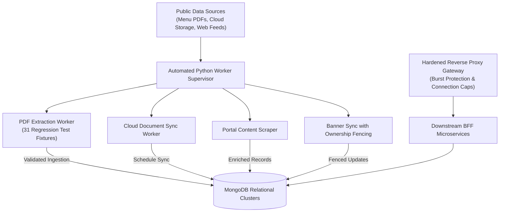
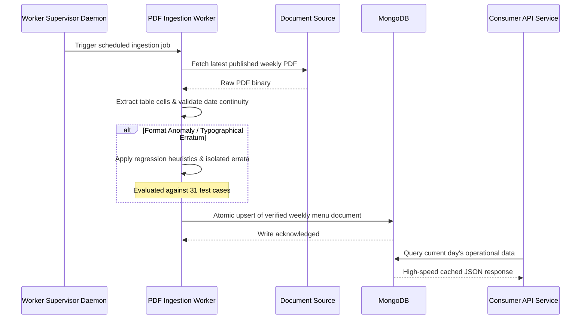

# Case Study 06: Fault-Tolerant Unstructured Document Ingestion Pipeline & Hardened API Gateway

## 1. Overview
This case study details the engineering of an automated, fault-tolerant ingestion pipeline and reverse proxy gateway designed to extract, validate, and synchronize structured data from unstructured institutional publications (multi-column weekly PDF tables, public cloud drives, and portal feeds) into a high-speed MongoDB datastore.

## 2. Context and Problem
The host enterprise lacked standardized programmatic APIs for operational data: meal menus were distributed exclusively as irregularly formatted weekly PDF files, transit timetables were periodically published to cloud storage folders, and announcements were posted through legacy CMS channels. Automated extraction was historically brittle—slight layout deviations or typographical errors in published PDFs broke parser routines or corrupted database records. Furthermore, automated sync runs risked overwriting manual editorial corrections made by staff in administrative dashboards.

## 3. My Contributions
- **Developed the PDF Dining Menu Parser with 31 Regression Tests:** Engineered a Python extraction engine capable of parsing complex multi-column weekly menu tables from unstructured PDFs. Handled edge cases including meal boundary detection, text footer anomalies, date errata, and full page coverage verification.
- **Implemented Write Fencing for Automated Scrapers:** Solved conflicts between manual portal edits and automated scrapers by designing ownership contracts, ensuring that manual administrative overrides in the admin panel are never overwritten by automated synchronizers.
- **Hardened the Reverse Proxy Gateway:** Hardened the public gateway configuration against denial-of-service and probe attacks, implementing strict burst limiting, client connection caps, and route protections.
- **Engineered Microservices Submodule Coordination:** Orchestrated Git submodules and deployment automation for downstream backend microservices, establishing consistent environment variable injection and connection string isolation.
- **Coordinated Production and Staging Rollouts:** Managed rollout pipelines across staging and production VPS environments, validating multi-container health before shifting DNS and proxy traffic.

## 4. Technical Architecture
The data ingestion supervisor operates under a fail-fast architectural design:

## 5. Technology Stack
- **Ingestion & Automation:** Python 3, PyPDF / PDFPlumber, BeautifulSoup, Schedule.
- **Microservices & BFFs:** Node.js, Express, TypeScript, Prisma ORM, MongoDB.
- **Infrastructure & Proxy:** Docker Compose, Nginx, Shell scripting, Git submodules.
- **Testing & Quality:** Pytest (31 unit & regression tests for parser), Jest.

## 6. Engineering Challenges
### 1. Inconsistent Weekly PDF Table Layouts and Errata
*Problem:* Administrative staff periodically published weekly tables with irregular column merges, incorrect month headers, or footnotes spanning across meal boundary cells, causing standard scrapers to scramble distinct meal schedules.
*Solution:* Built an intelligent table parser backed by 31 regression test fixtures capturing historical PDF layouts. The parser enforces column bounding boxes, terminates date searches at explicit meal headers, and applies isolated erratum patches for known administrative calendar typos.

### 2. Scrapers Overwriting Manual Content Overrides
*Problem:* When portal administrators manually updated announcement banners or corrected text in the admin dashboard, the scheduled sync worker overwrote those corrections during the next scraping pass.
*Solution:* Implemented an ownership fence pattern. Content records track their provenance (`source: 'scraper'` vs `source: 'manual'`). The worker inspects this flag and skips updating manually overridden fields while logging telemetry.

## 7. Engineering Practices
- **Fail-Fast Container Health:** If any of the worker threads encounters an unhandled fatal error, the supervisor process terminates entirely, triggering container orchestrator restart mechanisms rather than running in a degraded state.
- **Zero Hardcoded Database Names:** Refactored worker connection logic to extract database targets dynamically from the connection URI, preventing accidental cross-environment database pollution between staging and production.
- **Defensive Gateway Hardening:** Maintained strict rate limits, buffer allocations, and connection caps to safeguard backend services.

## 8. Results and Impact
- **299 verified commits** across the DevOps orchestration repository and backend microservice submodules.
- 100% automated daily menu ingestion with zero parser crashes across multiple operational cycles.
- Secure, rate-limited reverse proxy shielding backend services from automated scraping and abuse.

## 9. My Role
Lead DevOps Engineer and Ingestion Pipeline Architect. Collaborated with peer backend engineers, owning the automated sync workers, PDF parsing logic, reverse proxy security policies, and deployment operations.
