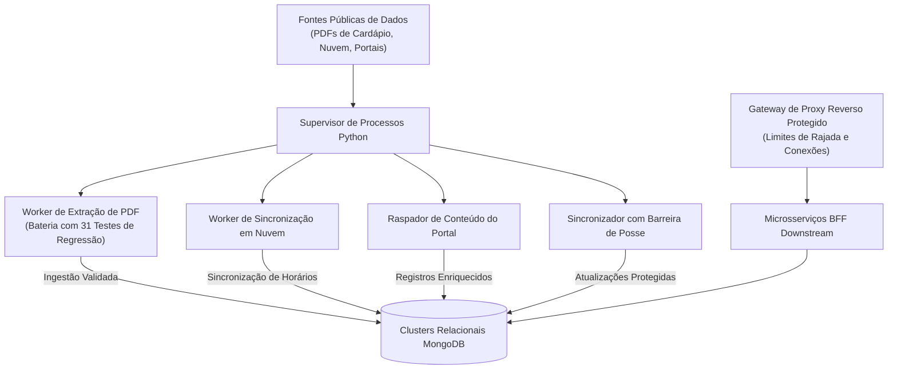
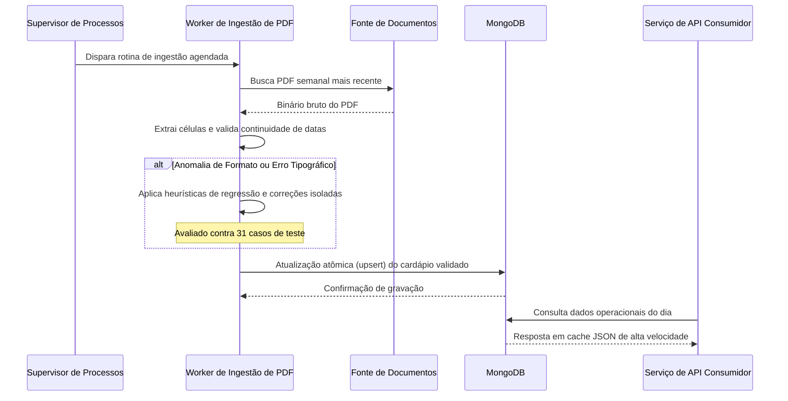

# Estudo de Caso 06: Pipeline Tolerante a Falhas para Ingestão de Documentos e Gateway Blindado

## 1. Visão Geral
Este estudo de caso aborda a engenharia de um pipeline automatizado e tolerante a falhas integrado a um gateway de proxy reverso. O sistema foi projetado para extrair, validar e sincronizar informações contidas em publicações institucionais não estruturadas (tabelas semanais em PDF de múltiplas colunas, pastas em nuvem e feeds de portais) em uma base de dados MongoDB de alta velocidade.

## 2. Contexto e Problema
A instituição não dispunha de APIs padronizadas para dados operacionais: cardápios semanais eram distribuídos unicamente como arquivos PDF com formatações irregulares, horários de transporte eram postados esporadicamente em pastas compartilhadas e informes eram publicados em sistemas legados. A extração automatizada tradicional era frágil: pequenas alterações de layout ou erros de digitação nos PDFs quebravam os scripts ou corrompiam dados no banco. Além disso, sincronizações automáticas corriam o risco de sobrescrever correções manuais efetuadas por operadores no painel administrativo.

## 3. Minhas Contribuições
- **Desenvolvimento do Analisador de Cardápio com 31 Testes de Regressão:** Criei um motor de extração em Python capaz de interpretar tabelas semanais em PDF com múltiplas colunas. Tratei casos limites como detecção de início e fim de refeições, rodapés com anotações e variações nas datas.
- **Implementação de Barreira de Posse para Sincronizadores:** Solucionei conflitos entre edições manuais no painel e rotinas automatizadas, criando contratos onde campos ajustados manualmente pela equipe administrativa nunca são sobrepostos por raspagens periódicas.
- **Blindagem do Gateway de Proxy Reverso:** Configurei políticas de segurança no proxy reverso contra ataques de negação de serviço e varreduras automáticas, adotando limites de rajada (burst limits), restrições de conexões simultâneas e proteção por rota.
- **Coordenação de Submódulos de Microsserviços:** Estruturei submódulos Git e automações de deploy para os microsserviços de backend, padronizando variáveis de ambiente e isolando cadeias de conexão.
- **Gerenciamento de Ambientes de Homologação e Produção:** Coordenei pipelines de entrega em servidores VPS, validando a integridade dos contêineres antes do redirecionamento de tráfego de DNS e proxy.

## 4. Arquitetura Técnica
O supervisor de ingestão opera sob o princípio de falha rápida (fail-fast):

## 5. Stack Tecnológica
- **Ingestão e Automação:** Python 3, PyPDF / PDFPlumber, BeautifulSoup, Schedule.
- **Microsserviços e BFFs:** Node.js, Express, TypeScript, Prisma ORM, MongoDB.
- **Infraestrutura e Proxy:** Docker Compose, Nginx, Shell scripting, submódulos Git.
- **Testes e Qualidade:** Pytest (31 testes de unidade e regressão para o parser), Jest.

## 6. Desafios de Engenharia
### 1. Inconsistências de Layout e Erros em Tabelas Semanais em PDF
*Problema:* Equipes administrativas publicavam tabelas semanais com mesclagens irregulares, nomes de meses incorretos ou notas de rodapé sobrepondo células de refeição, quebrando ferramentas comuns de extração.
*Solução:* Desenvolvi um analisador de tabelas validado por 31 baterias de testes de regressão com históricos reais de arquivos. O motor aplica coordenadas delimitadoras por coluna, interrompe buscas em cabeçalhos explícitos e aplica correções isoladas para erros recorrentes de digitação.

### 2. Sobrescrita de Alterações Manuais por Rotinas Automáticas
*Problema:* Sempre que administradores atualizavam avisos ou corrigiam informações no painel, a rotina de sincronização agendada sobrescrevia essas edições na rodada seguinte.
*Solução:* Implementei o padrão de barreira de posse. Os registros gravam a sua origem (`source: 'scraper'` contra `source: 'manual'`). O worker verifica esse indicador e preserva os campos ajustados manualmente enquanto emite telemetria.

## 7. Práticas de Engenharia
- **Falha Rápida em Contêineres:** Se qualquer thread do worker encontrar erro crítico não tratado, o processo supervisor é encerrado por completo, acionando o reinício automático pelo orquestrador em vez de operar com dados corrompidos.
- **Eliminação de Nomes de Bancos Hardcoded:** A lógica de conexão extrai o banco alvo dinamicamente da própria URI, prevenindo contaminações acidentais entre ambientes de teste e produção.
- **Políticas Defensivas no Gateway:** Aplicação de limites rigorosos de taxa de requisições, alocação controlada de buffers e teto de conexões para resguardar os serviços internos.

## 8. Resultados e Impacto
- **299 commits verificados** no repositório de orquestração de DevOps e nos submódulos de backend.
- 100% de ingestão automatizada dos cardápios diários sem paradas por quebra de layout durante múltiplos ciclos operacionais.
- Proxy reverso seguro com limitação de taxa protegendo serviços internos contra acessos abusivos.

## 9. Meu Papel
Engenheiro DevOps Principal e Arquiteto do Pipeline de Ingestão. Atuei em conjunto com desenvolvedores de backend, assumindo a liderança dos workers de sincronização, lógica do analisador de PDF, políticas de segurança no proxy e automação de deploys.
