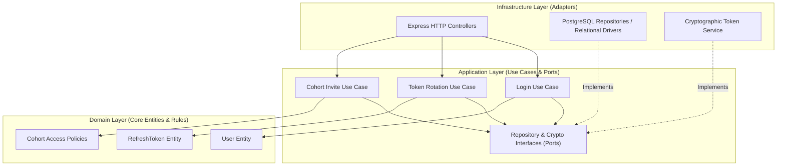
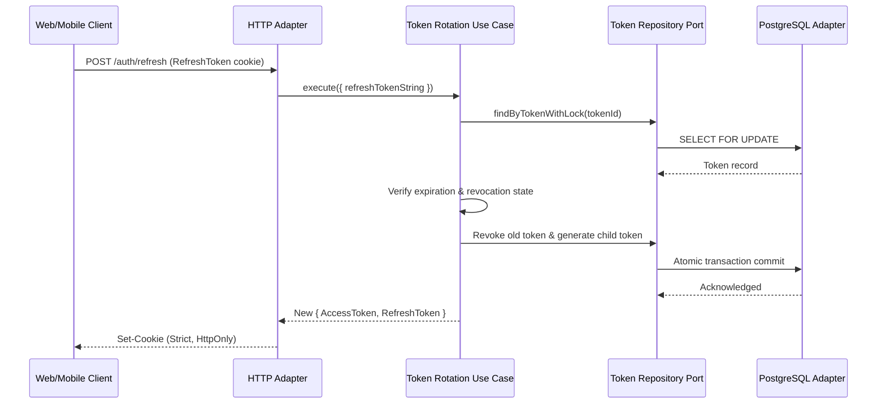

# Case Study 08: Hexagonal Architecture Identity & Access Management Microservice

## 1. Overview
This case study examines the architectural refactoring, token lifecycle security, and formal authorization testing of a standalone Identity and Access Management (IAM) microservice. Engineered with Node.js and TypeScript, the service implements Hexagonal Architecture (Ports and Adapters) and Clean Architecture principles, establishing a resilient authentication core decoupled from web frameworks and persistence technologies.

## 2. Context and Problem
The host platform coordinates multiple distributed research cohorts comprising instructors, field tutors, researchers, and system administrators. Earlier authentication code mixed database access directly inside HTTP route controllers, hindering automated unit testing and creating severe coupling. More critically, high-concurrency client environments (such as multiple simultaneous SPA requests) frequently produced race conditions during single-use refresh token rotation, causing valid user sessions to be accidentally invalidated and abruptly logged out.

## 3. My Contributions
- **Established Hexagonal / Clean Architecture:** Refactored the service into concentric layers (`domain`, `application`, `infrastructure`), defining strict ports (interfaces) for repositories and cryptographic services, enabling fast, isolated unit testing with in-memory doubles.
- **Engineered Concurrent Refresh Token Rotation:** Solved race conditions during automatic token refresh by introducing a graceful rotation grace window and atomic database revocation, preventing simultaneous requests from invalidating valid sessions.
- **Conducted Mutation Testing on Authorization Policies:** Implemented mutation testing suites for group composition rules, membership invitations, and claims generation, ensuring authorization gates cannot be bypassed by subtle conditional alterations.
- **Hardened System Resilience Against Database Glitches:** Implemented transient error recovery, circuit-breaking logic, and secure fallbacks to ensure user authentication checks fail closed rather than leaking access during database disruptions.
- **Built Role-Based Group Administration:** Implemented hierarchical claims for group tutors, administrative route guards, and idempotent database seed scripts for integration testing.

## 4. Technical Architecture
Dependencies strictly point inwards toward the core domain:

## 5. Technology Stack
- **Language & Architecture:** TypeScript, Hexagonal Architecture (Ports and Adapters).
- **Core Frameworks:** Node.js, Express.js, Zod (schema validation).
- **Persistence & Security:** PostgreSQL, JWT, Bcrypt.
- **Testing & Verification:** Jest (unit & in-memory integration), Mutation Testing (Stryker patterns).
- **Containerization:** Docker, Docker Compose.

## 6. Engineering Challenges
### 1. Session Revocation Collisions During Rapid Parallel Page Loads
*Problem:* When a user loaded a dashboard with multiple concurrent AJAX requests while their access token was expired, multiple requests simultaneously attempted to rotate the single-use refresh token. The first succeeded, but the subsequent requests detected a used token, triggered security alerts, and logged the user out.
*Solution:* Implemented an atomic database token consumption lock paired with a brief, strictly bounded grace period for concurrent in-flight requests originating from the exact same client handshake, allowing legitimate parallel requests to succeed while still preventing token reuse attacks.

### 2. Validating Complex Multi-Tenant Authorization Rules
*Problem:* Tutors needed permissions to review student articles within their own working group, but were strictly forbidden from viewing or approving submissions from other working groups. Standard unit tests often missed boundary flaws in multi-condition authorization logic.
*Solution:* Applied mutation testing against the authorization policy engine, deliberately mutating comparison operators and logical branches to verify that the test suite caught 100% of potential permission leaks.

## 7. Engineering Practices
- **Strict Inversion of Control:** Core domain entities and use cases have zero imports of Express, database drivers, or third-party web libraries.
- **Deterministic In-Memory Test Fixtures:** Developed fast in-memory repository implementations allowing the entire authentication test suite to run in milliseconds without launching a database container.
- **Zero Secret Hardcoding:** Environment configuration validated at boot time via Zod schemas, halting execution immediately if cryptographic secrets fail strength requirements.

## 8. Results and Impact
- **23 verified commits** establishing the architectural foundation, token rotation mechanics, mutation test suites, and group authorization logic.
- Complete elimination of false-positive session logouts under concurrent network loads.
- Proven authorization engine guaranteeing strict data isolation between regional research groups.

## 9. My Role
Core Backend Engineer and Security Architect. Responsible for the architectural structure, token lifecycle mechanics, mutation testing, and authorization policy implementation.
