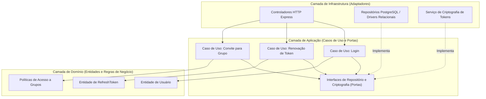
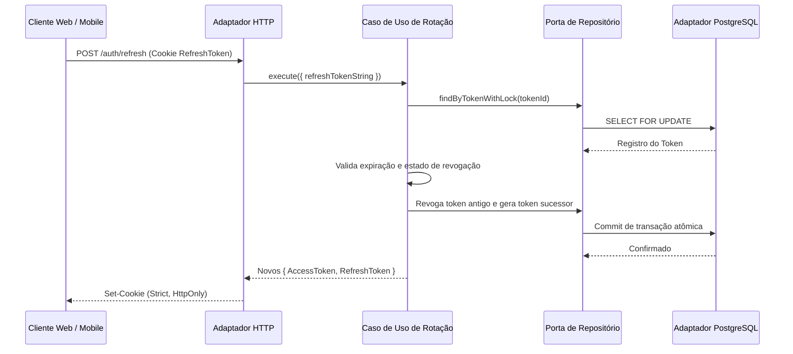

# Estudo de Caso 08: Microsserviço de Gestão de Identidade e Acesso em Arquitetura Hexagonal

## 1. Visão Geral
Este estudo de caso aborda a refatoração de arquitetura, a segurança do ciclo de vida de tokens e os testes de autorização de um microsserviço independente de Gestão de Identidade e Acesso (IAM). Desenvolvido em Node.js e TypeScript, o serviço adota os princípios de Arquitetura Hexagonal (Ports and Adapters) e Clean Architecture, estabelecendo um núcleo de autenticação resiliente e completamente isolado de frameworks web e bancos de dados.

## 2. Contexto e Problema
A plataforma atende a múltiplos grupos regionais de pesquisa compostos por orientadores, tutores de campo, estudantes e administradores. Códigos legados realizavam consultas a bancos diretamente dentro de controladores HTTP, dificultando a automação de testes unitários e gerando forte acoplamento. Em cenários de alta concorrência (como múltiplas requisições paralelas enviadas por uma aplicação SPA), ocorriam condições de corrida durante a renovação de tokens de uso único, causando encerramento indevido de sessões ativas de usuários.

## 3. Minhas Contribuições
- **Adoção de Arquitetura Hexagonal / Clean Architecture:** Estruturei o serviço em camadas concêntricas (`domain`, `application`, `infrastructure`), estabelecendo interfaces bem delimitadas (portas) para repositórios e serviços de criptografia, o que viabilizou testes rápidos e isolados usando implementações em memória.
- **Tratamento Concorrente de Renovação de Tokens:** Eliminei condições de corrida no processo de rotação atômica de refresh tokens por meio de uma janela curta de tolerância e revogação atômica no banco, prevenindo quedas involuntárias de sessão.
- **Testes de Mutação em Políticas de Autorização:** Submeti as regras de composição de grupos, convites de membros e concessão de papéis a baterias de testes de mutação, garantindo que alterações sutis em operadores lógicos sejam detectadas pela suite de testes.
- **Resiliência a Instabilidades Temporárias no Banco de Dados:** Implementei políticas de recuperação de falhas transitórias e mecanismos que asseguram que verificações de autenticação falhem com fechamento seguro em caso de indisponibilidade de persistência.
- **Gestão Hierárquica de Permissões:** Desenvolvi regras de acesso baseadas em papéis para tutores de grupos, filtros de rotas administrativas e rotinas idempotentes de carga inicial para testes de integração.

## 4. Arquitetura Técnica
As dependências apontam rigorosamente para o centro, na direção do domínio:

## 5. Stack Tecnológica
- **Linguagem e Arquitetura:** TypeScript, Arquitetura Hexagonal (Ports and Adapters).
- **Frameworks e Validação:** Node.js, Express.js, Zod (validação de esquemas).
- **Persistência e Segurança:** PostgreSQL, JWT, Bcrypt.
- **Testes e Qualidade:** Jest (testes unitários e de integração em memória), Testes de Mutação (padrões Stryker).
- **Contêineres:** Docker, Docker Compose.

## 6. Desafios de Engenharia
### 1. Colisão na Revogação de Sessão em Carregamentos Paralelos
*Problema:* Ao carregar um painel com diversas requisições AJAX simultâneas enquanto o access token estava expirado, várias chamadas tentavam renovar o refresh token de uso único ao mesmo tempo. A primeira concluía com êxito, mas as seguintes identificavam o token já utilizado, interpretavam como reutilização indevida e encerravam a sessão do usuário.
*Solução:* Implementei uma trava atômica de consumo no banco combinada a uma janela de carência estritamente delimitada para requisições concorrentes da mesma origem, viabilizando requisições simultâneas legítimas sem comprometer a defesa contra ataques de repetição.

### 2. Validação Rigorosa de Regras de Acesso Multi-Tenant
*Problema:* Tutores precisavam de autorização para avaliar produções acadêmicas do seu próprio grupo de trabalho, mas deviam ser estritamente bloqueados de consultar ou aprovar artigos de outros grupos. Testes unitários comuns frequentemente não cobriam todos os casos de borda em condições múltiplas.
*Solução:* Apliquei testes de mutação no mecanismo de autorização, alterando propositalmente operadores de comparação e ramos lógicos para comprovar que a bateria de testes detectava 100% de eventuais vazamentos de acesso.

## 7. Práticas de Engenharia
- **Inversão de Controle Estrita:** As entidades do domínio e casos de uso não importam Express, drivers de banco de dados nem bibliotecas de rede externas.
- **Testes Determinísticos com Mocks em Memória:** Implementações em memória dos repositórios permitem que toda a bateria de testes de autenticação execute em poucos milissegundos sem depender de contêineres de banco de dados ativos.
- **Validação de Variáveis de Ambiente no Boot:** Configurações críticas são avaliadas na inicialização via esquemas Zod, interrompendo a execução se as chaves criptográficas não atenderem aos requisitos de complexidade.

## 8. Resultados e Impacto
- **23 commits verificados** estabelecendo a estrutura de arquitetura, rotação atômica de tokens, suites de teste de mutação e regras de autorização de grupos.
- Fim definitivo dos falsos positivos de encerramento de sessão sob tráfego concorrente.
- Motor de autorização formalmente validado, assegurando isolamento de dados entre grupos regionais.

## 9. Meu Papel
Engenheiro Backend e Arquiteto de Segurança. Responsável pela modelagem de arquitetura, mecânicas do ciclo de vida dos tokens, automação dos testes de mutação e implementação das regras de controle de acesso.
