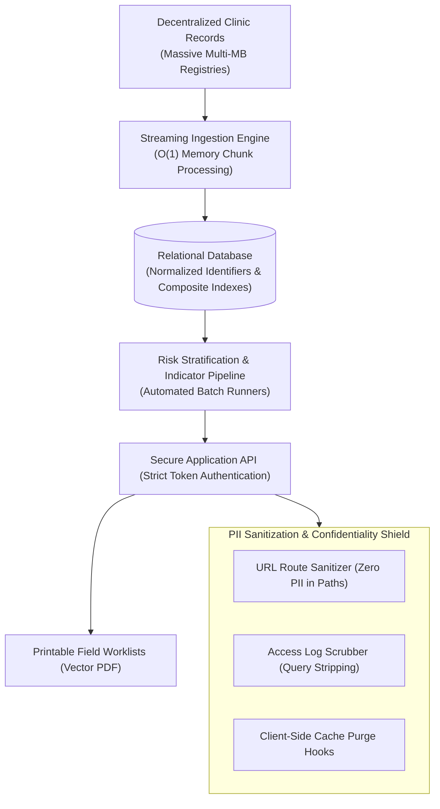
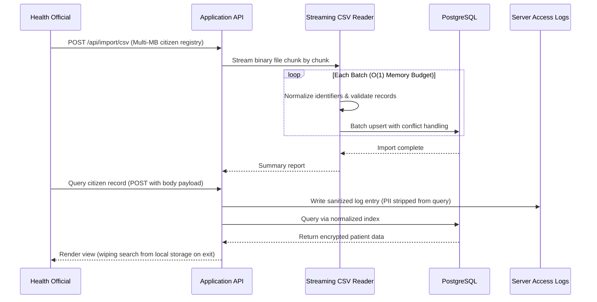

# Case Study 07: Scalable Clinical Record Ingestion & PII Sanitization Architecture

## 1. Overview
This case study documents the architectural overhaul, privacy hardening, and performance optimization of a healthcare intelligence and epidemiological monitoring platform. Operating in production on Linux virtual private servers, the platform ingests massive municipal health registries, tracks population health indicators (chronic conditions, prenatal care, preventive screenings), and generates operational field schedules for primary care outreach agents.

## 2. Context and Problem
Managing regional healthcare data requires aggregating records from decentralized primary care clinics into a unified analytical datastore. Health administrators faced two critical technical bottlenecks: first, importing multi-megabyte municipal citizen spreadsheets frequently crashed application servers due to out-of-memory (OOM) memory exhaustion; second, legacy web routes inadvertently exposed Personally Identifiable Information (PII) — specifically national citizen identification numbers (tax IDs) and patient search queries — in plain-text URL paths, reverse-proxy access logs, and persistent browser storage.

## 3. My Contributions
- **Engineered O(1) Memory Streaming Ingestion:** Replaced in-memory data loading with a generator-based streaming CSV reader, enabling the ingestion of massive citizen datasets without process memory growth.
- **Implemented Comprehensive PII Privacy Hardening:** Conducted rigorous privacy sanitization across the entire stack:
  - Eliminated citizen tax IDs from HTTP URL paths, replacing them with secure payload transfers.
  - Stripped sensitive query parameters from reverse proxy and application access logs.
  - Re-engineered frontend search panels to prevent storing patient names or documents in browser `localStorage`.
- **Built Population Risk Stratification & Indicators Automation:** Implemented algorithms for cross-referencing health registries, identifying high-risk patients lacking timely clinical evaluations, and automated daily calculation runs via bash scripts.
- **Designed Outreach Field Worklists & PDF Export:** Developed field assignment lists tailored for primary health outreach workers, featuring server-side pagination and exportable PDF field sheets.
- **Optimized Relational Database Performance:** Introduced normalized indexing schemes, composite indexes on health indicator tables, and eliminated full-table scan bottlenecks.
- **Hardened Production Deployment Profiles:** Configured Docker Compose production files, resolved host port collisions with existing hospital software running on host ports, and patched automated deployment workflows.

## 4. Technical Architecture
The data pipeline processes massive health records while enforcing strict privacy boundaries:

## 5. Technology Stack
- **Backend:** Python, Flask, Gunicorn, PostgreSQL, psycopg2.
- **Data Processing:** Streaming CSV parsers, PyPDF / ReportLab (field list generation).
- **Security & Privacy:** PyJWT, Bcrypt, Nginx log sanitization, data privacy compliance.
- **Infrastructure:** Docker, Docker Compose, Linux VPS, Git.
- **Code Quality:** Ruff (linting and formatting), OpenAPI specification snapshots.

## 6. Engineering Challenges
### 1. Out-of-Memory (OOM) Server Crashes During Municipal CSV Imports
*Problem:* Importing municipal spreadsheets containing tens of thousands of patient records using standard in-memory Pandas/Python readers consumed several gigabytes of RAM, crashing the VPS container.
*Solution:* Designed an iterative streaming processor using Python generators and chunked buffer reads. Records are read line-by-line, validated, and flushed to PostgreSQL in fixed batch transactions, keeping process memory strictly constant at under 80 MB regardless of file size.

### 2. Leaking Patient PII in Web Server Access Logs
*Problem:* Standard REST endpoints like `GET /api/paciente/<cpf>` caused plain-text citizen tax IDs to be written directly to web server access logs and intermediate proxies.
*Solution:* Restructured all patient-specific retrieval routes to accept identification tokens within encrypted request bodies or authorization headers, and reconfigured logging formatters to systematically strip query strings from access logs.

## 7. Engineering Practices
- **Strict Data Segregation and Ignoring:** Enforced strict `.gitignore` rules blocking all raw data spreadsheets and municipal text exports from ever entering Git version control.
- **Automated Regression Auditing:** Maintained continuous automated test suites formatted with Ruff, accompanied by OpenAPI snapshots to prevent API contract breaking changes.
- **Production Infrastructure Isolation:** Isolated development and production Docker Compose profiles to prevent port collisions with existing hospital software running on host servers.

## 8. Results and Impact
- **259 verified commits** delivering the ingestion engine, privacy architecture, risk stratification, and production deployment scripts.
- Processing of municipal citizen registries with zero OOM errors and minimal server memory consumption.
- Complete compliance with healthcare privacy guidelines and elimination of sensitive citizen identification data from access logs.

## 9. My Role
Lead Systems Engineer and Data Privacy Architect. Designed and implemented the streaming ingestion pipeline, database performance indexing, privacy sanitization measures, and production Docker containerization.
