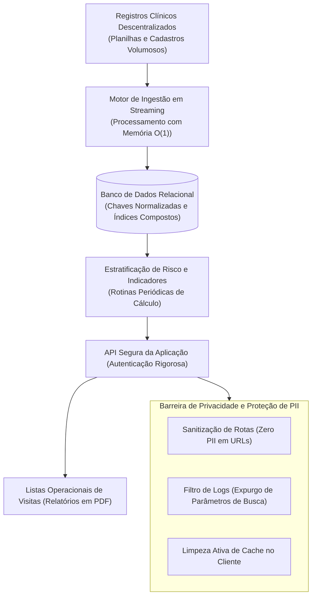
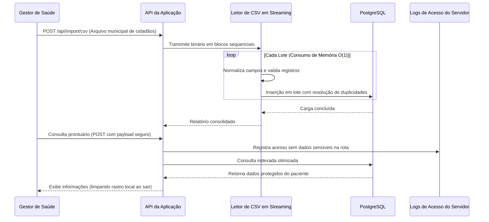

# Estudo de Caso 07: Ingestão Escalável de Prontuários Clínicos e Sanitização de Dados Sensíveis (PII)

  
  
  
  
  
  

## 1. Visão Geral
Este estudo de caso documenta a modernização arquitetural, o reforço de privacidade e a otimização de desempenho de uma plataforma de monitoramento epidemiológico e gestão em saúde básica. Operando em produção sobre servidores virtuais Linux (VPS), a plataforma ingere cadastros municipais volumosos de cidadãos, monitora indicadores da Atenção Primária (como hipertensão, diabetes, pré-natal e exames preventivos) e gera relatórios operacionais para as equipes de saúde da família.

## 2. Contexto e Problema
A integração de registros de unidades de saúde descentralizadas em uma base analítica centralizada enfrentava dois gargalos críticos: primeiro, a importação de planilhas municipais extensas causava frequentes estouros de memória (Out-Of-Memory / OOM) e derrubava os servidores; segundo, rotas web antigas expunham dados de identificação pessoal (PII), especialmente números de CPF e termos de busca de pacientes, em texto aberto nos caminhos das URLs, nos registros de acesso dos servidores web e no armazenamento local dos navegadores.

## 3. Minhas Contribuições
- **Ingestão em Streaming com Memória Constante O(1):** Substituí leituras que carregavam arquivos inteiros na memória por um leitor de CSV em streaming baseado em geradores Python, permitindo importar bases municipais de qualquer tamanho com consumo plano de memória.
- **Proteção Completa contra Exposição de PII:** Implementei medidas rigorosas de privacidade em toda a arquitetura do sistema:
  - Removi números de CPF dos caminhos de URL HTTP, substituindo consultas diretas por envios encapsulados no corpo de requisições autenticadas.
  - Eliminei parâmetros sensíveis de busca dos logs de acesso do proxy reverso e da aplicação.
  - Ajustei formulários de busca no frontend para evitar a persistência indevida de dados de pacientes no `localStorage` do navegador.
- **Automação de Indicadores e Estratificação de Risco:** Programei algoritmos para cruzar registros de saúde, apontar pacientes em faixas prioritárias com pendências de acompanhamento clínico e automatizei execuções diárias via scripts em bash.
- **Listas de Trabalho de Campo e Exportação em PDF:** Desenvolvi visualizações paginadas no servidor com exportação de relatórios em PDF adaptados para orientar as visitas domiciliares dos agentes de saúde.
- **Otimização de Consultas no PostgreSQL:** Criei índices compostos e estruturas normalizadas de consulta nas tabelas de indicadores, acabando com travamentos causados por varreduras completas de tabelas (full table scans).
- **Adequação dos Ambientes de Publicação:** Ajustei manifestos do Docker Compose para produção, solucionei conflitos de portas com outros sistemas de saúde instalados no mesmo servidor e estabilizei as esteiras de deploy.

## 4. Arquitetura Técnica
O fluxo de dados processa cadastros extensos aplicando barreiras rígidas de proteção:

## 5. Stack Tecnológica
- **Backend:** Python, Flask, Gunicorn, PostgreSQL, psycopg2.
- **Processamento de Dados:** Leitores de CSV iterativos, PyPDF / ReportLab (geração de listas em PDF).
- **Segurança e Privacidade:** PyJWT, Bcrypt, filtros de logs no Nginx, conformidade com a LGPD.
- **Infraestrutura:** Docker, Docker Compose, VPS Linux, Git.
- **Qualidade de Código:** Ruff (padronização e linting), validações de contratos OpenAPI.

## 6. Desafios de Engenharia
### 1. Paradas de Servidor por Estouro de Memória (OOM) na Importação de CSVs
*Problema:* A leitura de planilhas de municípios com dezenas de milhares de munícipes usando bibliotecas tradicionais que carregam todo o conteúdo na memória exigia vários gigabytes de RAM, derrubando o contêiner do servidor.
*Solução:* Desenvolvi um pipeline de leitura em streaming utilizando geradores Python que analisa o arquivo linha por linha, valida os dados e envia ao PostgreSQL em lotes transacionais de tamanho fixo. O consumo de memória do processo permanece constante abaixo de 80 MB, independentemente do volume do arquivo.

### 2. Vazamento de Identificadores de Pacientes em Logs de Acesso Web
*Problema:* Endpoints comuns como `GET /api/paciente/<cpf>` gravavam o número de CPF do munícipe diretamente nos arquivos de log do servidor Nginx e em proxies intermediários.
*Solução:* Reestruturei as rotas de consulta para trafegar dados sensíveis apenas em requisições seguras com corpo criptografado ou cabeçalhos autenticados, além de reconfigurar os formatos de log do servidor para suprimir argumentos de consulta.

## 7. Práticas de Engenharia
- **Tratamento Rigoroso de Dados no Git:** Definição de regras estritas no `.gitignore` para assegurar que nenhuma planilha bruta ou extração de dados reais jamais entre no versionamento.
- **Testes Automatizados Contínuos:** Manutenção de testes organizados com Ruff e acompanhados de especificações OpenAPI para prevenir alterações acidentais nos contratos da API.
- **Isolamento de Infraestrutura em Servidores Compartilhados:** Configuração detalhada das portas e volumes no Docker Compose para evitar sobreposições com serviços legados em execução no servidor.

## 8. Resultados e Impacto
- **259 commits verificados** cobrindo o mecanismo de ingestão, regras de privacidade, rotinas de cálculo de risco e scripts de deploy.
- Capacidade de carregar grandes bases municipais sem travamentos e com consumo mínimo de recursos.
- Adequação completa às diretrizes de privacidade da LGPD e fim definitivo do vazamento de documentos em logs.

## 9. Meu Papel
Engenheiro de Sistemas e Arquiteto de Privacidade de Dados. Projetei e implementei a ingestão em streaming, a otimização de índices no banco de dados, os filtros de sanitização de PII e a infraestrutura de contêineres Docker.
