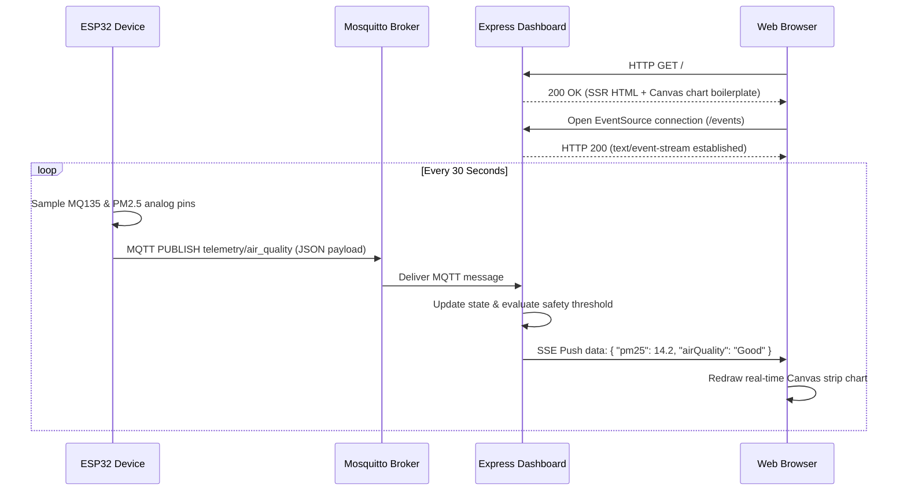

# Case Study 10: Real-Time Environmental Telemetry Firmware & Event-Driven Dashboard

## 1. Overview
This case study examines the development of an integrated Internet of Things (IoT) air quality monitoring ecosystem. The system comprises embedded C++ firmware running on an ESP32 microcontroller, an Eclipse Mosquitto MQTT broker, an event subscriber service, and a Node.js dashboard featuring server-side rendering (SSR) and real-time telemetry streaming via Server-Sent Events (SSE).

## 2. Context and Problem
Monitoring indoor environmental safety requires continuous sampling of volatile organic compounds, hazardous gases (via MQ135 sensors), and particulate matter (via PM2.5 optical dust sensors). Traditional polling architectures place excessive connection strain on low-power microcontrollers and web clients. The goal was to establish an event-driven pub/sub topology where low-power edge devices sample continuously while transmitting at optimized intervals, and client dashboards receive push updates without periodic polling.

```mermaid
graph LR
    ESP32["ESP32 Microcontroller<br/>(C++ Firmware / Sensors)"]
    Broker["Eclipse Mosquitto<br/>(MQTT Broker :1883)"]
    Subscriber["Node.js Console Subscriber<br/>(Debug & Audit)"]
    Dashboard["Node.js Express Server<br/>(SSR HTML + State Engine)"]
    Browser["Client Web Browser<br/>(HTML5 Canvas + SSE Stream)"]

    ESP32 -->|MQTT Telemetry (30s)| Broker
    Broker -->|Topic Subscription| Subscriber
    Broker -->|Topic Subscription| Dashboard
    Dashboard -->|Initial SSR View| Browser
    Dashboard -->|Push Live Events via SSE| Browser
```

## 3. My Contributions
- **Authored the ESP32 Microcontroller Firmware:** Wrote modular C++ Arduino firmware for ESP32, configuring WiFi connectivity, PubSubClient MQTT communication, analog sensor sampling at 1 Hz, and batched JSON telemetry payload dispatch every 30 seconds.
- **Configured Containerized Mosquitto MQTT Broker:** Defined Docker Compose topologies orchestrating the Eclipse Mosquitto message broker, establishing custom port listeners and network isolation.
- **Engineered an SSR Web Dashboard with Server-Sent Events (SSE):** Developed a Node.js Express application utilizing EJS templating for instant server-rendered initial loads, combined with an active SSE endpoint (`/events`) streaming telemetry updates directly into client-side Canvas charts without page refreshes.
- **Implemented Sensor Calibration & Environmental Classification:** Implemented baseline calibration curves for gas resistance ratios and particulate density calculations, categorizing ambient air quality into qualitative safety thresholds (Good, Moderate, Poor).

## 4. Technical Architecture
The telemetry pipeline isolates hardware dispatch from client rendering:



## 5. Technology Stack
- **Embedded & Hardware:** C++, Arduino framework, ESP32 DevKit, PubSubClient, Wokwi simulation environment.
- **Messaging:** Eclipse Mosquitto MQTT Broker.
- **Backend & Web:** Node.js, Express.js, EJS (Server-Side Rendering), Server-Sent Events (SSE).
- **Frontend:** Vanilla JavaScript, HTML5 Canvas API, CSS3.
- **Infrastructure:** Docker, Docker Compose.

## 6. Engineering Challenges
### 1. Reconciling High-Frequency Sensor Reads with Network Efficiency
*Problem:* Continuous WiFi transmissions on microcontrollers cause significant power dissipation and network congestion, while low-frequency sampling risks missing sudden hazardous gas spikes.
*Solution:* Implemented an internal decoupled sampling loop: the firmware samples analog pins at 1 Hz into a moving-average buffer, detecting sudden threshold exceedances immediately, while dispatching steady-state MQTT packets only once every 30 seconds.

### 2. Client-Side Overhead in Real-Time Web Graphing
*Problem:* Heavy third-party charting libraries caused substantial CPU overhead and DOM churn when updating live real-time streams in browser tabs left open for days.
*Solution:* Built a lightweight, custom HTML5 Canvas rendering engine with zero third-party framework overhead, drawing smooth time-series charts directly onto an offscreen canvas buffer.

## 7. Engineering Practices
- **Decoupled Subscriber Architecture:** Maintained an independent headless Node.js subscriber container to log and audit raw broker traffic without interfering with dashboard HTTP rendering.
- **Containerized Development Parity:** Packaged the entire stack (broker, subscriber, web server) into a multi-container Docker Compose configuration capable of bootstrapping with a single command.
- **Zero-Polling SSE Communication:** Eliminated repetitive HTTP polling by utilizing unidirectional Server-Sent Events over a persistent HTTP/1.1 connection.

## 8. Results and Impact
- **3 verified commits** establishing the complete hardware firmware, MQTT broker setup, and real-time SSE dashboard.
- Stable real-time telemetry streaming with sub-50ms latency from broker receipt to browser visual update.
- Completely reproducible Docker test environment for MQTT IoT applications.

## 9. My Role
Sole Systems Engineer and Firmware Developer. Authored the ESP32 C++ firmware, configured the Mosquitto broker, and developed the real-time Node.js dashboard.
