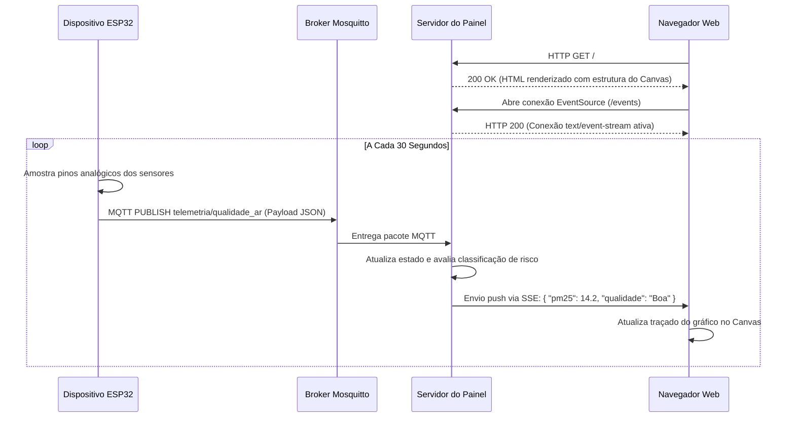

# Estudo de Caso 10: Firmware para Telemetria Ambiental e Painel em Tempo Real Orientado a Eventos

<p align="left">
  
  
  
  
  
  
</p>


## 1. Visão Geral
Este estudo de caso documenta o desenvolvimento de um ecossistema integrado de monitoramento de qualidade do ar baseado em Internet das Coisas (IoT). O projeto é formado por um firmware embarcado em C++ executado em um microcontrolador ESP32, um broker MQTT Eclipse Mosquitto, um serviço ouvinte de auditoria e um painel web em Node.js com renderização no servidor (SSR) e transmissão contínua de telemetria via Server-Sent Events (SSE).

## 2. Contexto e Problema
A avaliação da salubridade do ar em ambientes internos exige leitura contínua de gases inflamáveis ou tóxicos (via sensores analógicos MQ135) e concentração de material particulado fino (via sensores ópticos PM2.5). Arquiteturas baseadas em polling contínuo geram sobrecarga de conexão em microcontroladores de baixo consumo e nos clientes web. O objetivo foi estabelecer uma topologia orientada a eventos (pub/sub) onde os nós embarcados leem os dados de forma ininterrupta, transmitem em intervalos otimizados e a interface web recebe as atualizações instantaneamente por push.

```mermaid
graph LR
    ESP32["Microcontrolador ESP32<br/>(Firmware C++ / Sensores)"]
    Broker["Eclipse Mosquitto<br/>(Broker MQTT Porta 1883)"]
    Subscriber["Ouvinte em Console Node.js<br/>(Depuração e Auditoria)"]
    Dashboard["Servidor Node.js / Express<br/>(HTML com SSR e Estado)"]
    Browser["Navegador Web do Usuário<br/>(HTML5 Canvas e Fluxo SSE)"]

    ESP32 -->|Telemetria MQTT (30s)| Broker
    Broker -->|Assinatura de Tópico| Subscriber
    Broker -->|Assinatura de Tópico| Dashboard
    Dashboard -->|Página Inicial com SSR| Browser
    Dashboard -->|Envio de Eventos via SSE| Browser
```

## 3. Minhas Contribuições
- **Desenvolvimento do Firmware Embarcado para ESP32:** Escrevi firmware modular em C++ para ESP32 com o framework Arduino, programando reconexão Wi-Fi, comunicação MQTT com a biblioteca PubSubClient, leitura de sensores a 1 Hz e envio de pacotes estruturados em JSON a cada 30 segundos.
- **Configuração do Broker MQTT Mosquitto em Contêiner:** Defini as configurações do broker Eclipse Mosquitto via Docker Compose, ajustando portas de escuta e isolamento de rede interna.
- **Construção de Painel Web SSR com Server-Sent Events (SSE):** Desenvolvi a aplicação em Node.js e Express com templates EJS para entrega imediata do HTML inicial renderizado no servidor, integrada a um endpoint de SSE (`/events`) que transmite os dados diretamente para os gráficos do navegador.
- **Calibração e Classificação dos Níveis de Qualidade do Ar:** Implementei curvas de calibração baseadas nas características elétricas dos sensores para calcular densidade de partículas e níveis de gases, categorizando o ambiente em faixas de qualidade (Boa, Moderada, Ruim).

## 4. Arquitetura Técnica
O fluxo de telemetria desacopla as transmissões do hardware do consumo nos navegadores:



## 5. Stack Tecnológica
- **Embarcados e Hardware:** C++, Framework Arduino, ESP32 DevKit, PubSubClient, ambiente de simulação Wokwi.
- **Mensageria:** Broker MQTT Eclipse Mosquitto.
- **Backend e Servidor Web:** Node.js, Express.js, EJS (Server-Side Rendering), Server-Sent Events (SSE).
- **Frontend:** JavaScript Vanilla, HTML5 Canvas API, CSS3.
- **Infraestrutura:** Docker, Docker Compose.

## 6. Desafios de Engenharia
### 1. Conciliar Alta Frequência de Amostragem com Baixo Consumo de Rede
*Problema:* Transmissões contínuas por Wi-Fi em microcontroladores aumentam o aquecimento e o consumo de energia, mas leituras esparsas poderiam perder picos momentâneos de fumaça ou gás.
*Solução:* Separei a leitura da transmissão: o firmware amostra os pinos analógicos a 1 Hz acumulando valores em uma média móvel para detectar aumentos abruptos imediatamente, enquanto o pacote consolidado de telemetria é despachado via MQTT apenas uma vez a cada 30 segundos.

### 2. Sobrecarga de Renderização em Gráficos em Tempo Real
*Problema:* Bibliotecas complexas de gráficos para navegadores geravam alto consumo de memória e processamento ao atualizar dados contínuos durante longos períodos de monitoramento.
*Solução:* Desenvolvi um motor gráfico sob medida utilizando diretamente a API HTML5 Canvas, desenhando os pontos temporais em uma tela em buffer sem dependências externas nem manipulação do DOM.

## 7. Práticas de Engenharia
- **Serviço Ouvinte Desacoplado:** Manutenção de um processo independente em Node.js para registrar mensagens brutas do broker sem interferir nas rotas web do painel.
- **Ambiente de Desenvolvimento em Contêineres:** Integração do broker, do ouvinte e do painel web em um manifesto Docker Compose único, permitindo subir todo o sistema com um comando.
- **Comunicação por Push sem Polling:** Utilização de Server-Sent Events sobre uma única conexão HTTP persistente, eliminando requisições repetitivas ao servidor.

## 8. Resultados e Impacto
- **3 commits verificados** estabelecendo o firmware completo, a infraestrutura do broker MQTT e o painel em tempo real.
- Transmissão contínua de medições com latência inferior a 50 ms entre a chegada no broker e a atualização na tela.
- Ambiente de simulação e execução com contêineres totalmente reproduzível para aplicações IoT.

## 9. Meu Papel
Engenheiro de Sistemas e Desenvolvedor de Firmware Único. Programei o firmware em C++ para ESP32, estruturei o broker Mosquitto e desenvolvi a aplicação web com SSE.
