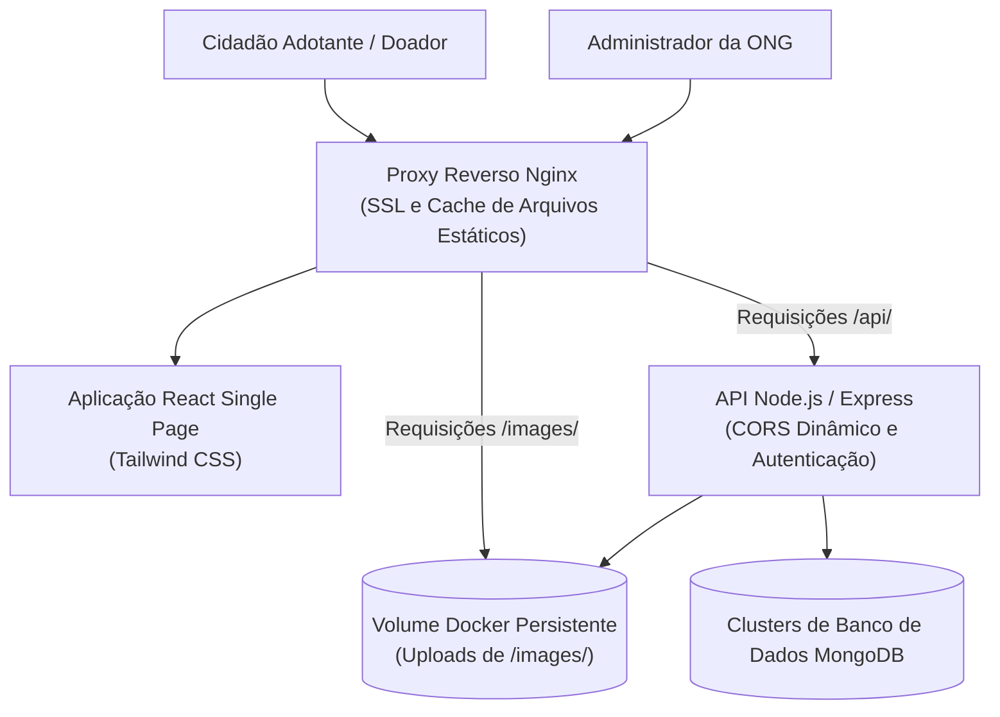
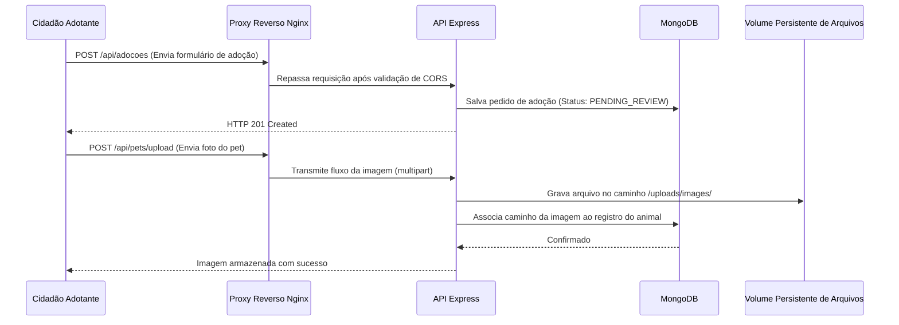

# Estudo de Caso 13: Sistema Full-Stack para Gestão de Adoções e Bem-Estar Comunitário

## 1. Visão Geral
Este estudo de caso detalha a concepção, desenvolvimento e publicação em nuvem de uma aplicação web full-stack criada para coordenar ações voluntárias de proteção animal, triagem de pedidos de adoção e acompanhamento de campanhas de doação. Desenvolvida com frontend em React e backend em Node.js, Express e MongoDB, a plataforma conta com painel administrativo, troca de mensagens, etapas de avaliação e deploy contínuo baseado em contêineres Docker.

## 2. Contexto e Problema
Organizações voluntárias de resgate animal frequentemente atuam sem sistemas estruturados, dependendo de publicações espalhadas em redes sociais e conversas privadas. Essa dinâmica leva à perda de candidaturas de adoção, dificuldades na checagem dos adotantes e falta de controle sobre doações recebidas. O objetivo foi fornecer uma plataforma organizada com fichas detalhadas dos animais, etapas formais de triagem e painel de controle para os administradores.

## 3. Minhas Contribuições
- **Estruturação Completa da Plataforma:** Desenvolvi a arquitetura inicial do sistema (`feat: add full platform`), abrangendo autenticação de usuários, painel administrativo, cadastro estruturado de animais, triagem de candidaturas de adoção e avisos.
- **Configuração de CORS Dinâmico para Múltiplas Origens:** Implementei um middleware flexível que aceita origens separadas por vírgula a partir de variáveis de ambiente (`CLIENT_URL`), permitindo testes seguros em desenvolvimento local, prévias de homologação e produção.
- **Persistência de Mídias com Volumes Docker:** Configurei rotas no proxy Nginx e volumes persistentes no Docker para desacoplar as imagens enviadas pelos usuários (`/images/`) do ciclo de vida dos contêineres da aplicação.
- **Automação de Deploys com GitHub Actions:** Estruturei pipelines de integração e entrega contínua com envio de imagens para o GitHub Container Registry (GHCR) e atualização automatizada via SSH em servidores Linux na Oracle Cloud.

## 4. Arquitetura Técnica
A topologia de publicação isola a entrega de arquivos estáticos das rotinas da API:

## 5. Stack Tecnológica
- **Backend:** Node.js, Express.js, MongoDB, Mongoose ODM.
- **Frontend:** React, React Router, Tailwind CSS, JavaScript.
- **Infraestrutura e Proxy:** Docker, Docker Compose, Nginx.
- **DevOps e Nuvem:** GitHub Actions, GHCR (GitHub Container Registry), VPS Linux na Oracle Cloud.

## 6. Desafios de Engenharia
### 1. Bloqueios de CORS em Ambientes de Teste Dinâmicos
*Problema:* Configurações com domínios fixos de CORS impediam o consumo da API durante validações em endereços temporários de homologação ou dispositivos em rede local.
*Solução:* Programei um middleware customizado que interpreta origens configuradas em variáveis de ambiente e valida a origem das requisições contra uma lista permitida antes de emitir os cabeçalhos de segurança.

### 2. Perda de Imagens em Atualizações de Contêineres
*Problema:* Nos primeiros deploys com Docker, as fotos enviadas ficavam no sistema de arquivos interno do contêiner, sendo perdidas a cada nova versão publicada.
*Solução:* Ajustei os arquivos do Docker Compose para montar volumes persistentes no disco do servidor vinculados à pasta `/uploads`, orientando o Nginx a servir `/images/` diretamente do disco para reduzir a carga sobre o backend.

## 7. Práticas de Engenharia
- **Isolamento de Variáveis de Ambiente:** Modelagem de arquivos `.env.example` completos e filtros no `.gitignore` para assegurar que chaves secretas e configurações de banco nunca cheguem aos repositórios.
- **Entrega Contínua Automatizada:** Publicação automática de imagens de contêineres a cada commit na branch principal por meio de fluxos do GitHub Actions.
- **Perfis Limpos de Docker Compose:** Criação de manifestos separados para agilidade no desenvolvimento local e estabilidade em ambientes de produção.

## 8. Resultados e Impacto
- **12 commits verificados** contendo a estrutura da plataforma, fluxos de avaliação de adoção, arquivos de contêiner e esteiras automatizadas de deploy.
- Plataforma estável com persistência segura de mídias e fluxo completo de triagem de animais resgatados.
- Atualização contínua de versões em servidores na nuvem sem paradas manuais de serviço.

## 9. Meu Papel
Desenvolvedor Full-Stack Líder e Engenheiro DevOps. Projetei os esquemas no MongoDB, desenvolvi as APIs em Express, criei a interface em React e configurei a infraestrutura de publicação com Docker e Nginx.
