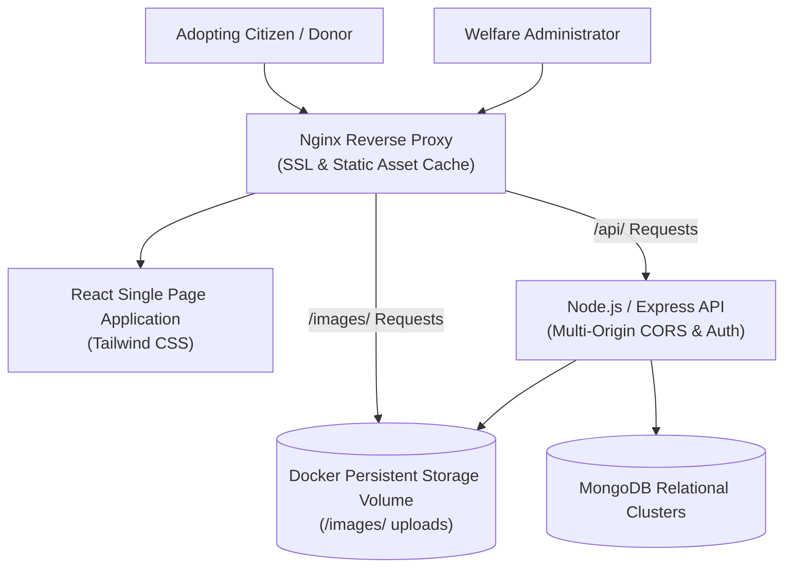
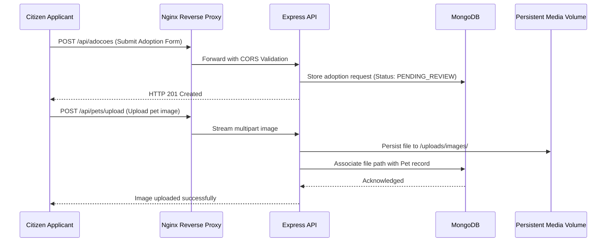

# Case Study 13: Full-Stack Community Welfare & Adoption Management System

## 1. Overview
This case study details the development and cloud deployment of a full-stack web application designed to coordinate community animal welfare initiatives, facilitate pet adoption applications, and streamline charitable donation drives. Built with a React frontend and a Node.js/Express/MongoDB backend, the application features an administrative portal, real-time messaging, review workflows, and automated containerized cloud deployments.

## 2. Context and Problem
Grassroots community animal protection organizations frequently operate without central software infrastructure, relying on disparate social media groups and private messaging. This leads to lost adoption applications, unvetted caretaker handoffs, and difficulties in coordinating donation tracking. The project sought to provide a centralized platform with structured pet profiles, multi-step adoption vetting workflows, and an administrative oversight panel.

## 3. My Contributions
- **Delivered the Core Platform Architecture:** Implemented the complete initial platform architecture (`feat: add full platform`), incorporating user authentication, an administrative control panel, structured pet profile management, adoption application workflows, and notification systems.
- **Configured Dynamic Multi-Origin CORS:** Engineered flexible CORS middleware supporting comma-separated origin strings from environment variables (`CLIENT_URL`), enabling seamless communication across local development, staging previews, and production domains.
- **Architected Static Asset Volume Persistence:** Configured Nginx reverse proxy routes and Docker persistent storage volumes to decouple user-uploaded pet photographs (`/images/`) from ephemeral container lifecycles.
- **Automated Cloud Deployments via GitHub Actions:** Authored automated CI/CD workflows utilizing GitHub Container Registry (GHCR) and automated SSH triggers for hands-off deployment to Oracle Cloud Linux virtual servers.

## 4. Technical Architecture
The containerized deployment topology balances web serving and API isolation:

## 5. Technology Stack
- **Backend:** Node.js, Express.js, MongoDB, Mongoose ODM.
- **Frontend:** React, React Router, Tailwind CSS, JavaScript.
- **Infrastructure & Proxy:** Docker, Docker Compose, Nginx.
- **DevOps & Cloud:** GitHub Actions, GHCR (GitHub Container Registry), Oracle Cloud VPS.

## 6. Engineering Challenges
### 1. Cross-Origin Resource Sharing (CORS) Restrictions Across Preview Domains
*Problem:* Static single-domain CORS configurations broke API access when previewing staging builds on temporary deployment URLs and local network testing devices.
*Solution:* Implemented dynamic CORS middleware that parses comma-separated allowed origins from the environment, validating incoming request origins against an approved whitelist regex before dispatching headers.

### 2. Ephemeral Container Image Loss
*Problem:* In early Docker deployments, uploaded pet photographs were stored inside the container filesystem, causing all user-uploaded images to be wiped whenever a new container image was deployed.
*Solution:* Restructured Docker Compose configurations to mount a persistent host volume mapped to the backend's `/uploads` path, and configured Nginx to serve `/images/` directly from the host volume to reduce backend CPU overhead.

## 7. Engineering Practices
- **Strict Environment Isolation:** Maintained exhaustive `.env.example` templates and strict `.gitignore` rules ensuring that secrets, local database dumps, and server keys never enter source repositories.
- **Automated Continuous Delivery:** Deployed containerized micro-images automatically upon code merges to the main branch via GitHub Actions workflows.
- **Clean Docker Compose Profiles:** Built independent development and production Compose manifests tailored for rapid local prototyping and hardened production hosting.

## 8. Results and Impact
- **12 verified commits** providing the full-stack codebase, administrative review flows, Docker configurations, and automated CI/CD pipelines.
- Production-ready community animal adoption platform with persistent media storage.
- Automated zero-downtime container updates on cloud virtual private servers.

## 9. My Role
Lead Full-Stack Developer and DevOps Engineer. Designed the MongoDB data models, authored the Express backend APIs, developed the React frontend, and built the Docker/Nginx deployment infrastructure.
