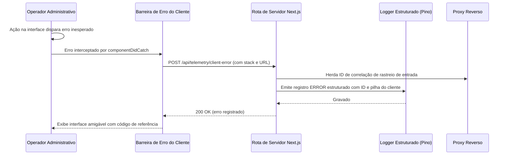

# Estudo de Caso 05: Portal Corporativo Multi-Tenant com Rastreamento de Erros Cliente-Servidor

## 1. Visão Geral
Este estudo de caso analisa o desenvolvimento de um portal web corporativo construído com Next.js e TypeScript, projetado para coordenar fluxos administrativos de múltiplos setores. A plataforma gerencia horários de transporte em tempo real, escalas de frotas e motoristas, cardápios de restaurantes universitários, banners dinâmicos e comunicados oficiais sob controle de acesso baseado em departamentos.

## 2. Contexto e Problema
A coordenação de serviços organizacionais descentralizados envolve diversos departamentos independentes (como operadores de transporte, assessoria de comunicação e fiscais de alimentação). A gestão anterior sofria com sobreposição de acessos, onde servidores de um setor podiam inadvertidamente alterar dados de outro departamento. Além disso, falhas não tratadas nos navegadores dos operadores não geravam telemetria no servidor, impedindo a reprodução de erros de produção sem contato direto com o usuário.

```mermaid
graph TD
    Admin["Administrador do Setor"]
    UI["Portal de Operações Next.js (React / TS)"]
    ErrorBoundary["Barreira de Erro no Cliente"]
    ServerLogger["Logger Estruturado do Servidor"]
    RBAC["Validador de Escopo Departamental"]
    API["Gateway de Microsserviços (Proxy Reverso)"]

    Admin --> UI
    UI -->|Erro React Não Tratado| ErrorBoundary
    ErrorBoundary -->|Envia Stack de Erro + ID de Rastreio| ServerLogger
    UI -->|Ações (Notícias, Banners, Frota)| RBAC
    RBAC -->|Garante Escopo Departamental| API
    API -->|Propaga ID de Correlação de Rastreio| ServerLogger
```

## 3. Minhas Contribuições
- **Rastreamento de Erros de Ponta a Ponta do Cliente ao Servidor:** Conectei barreiras de erro do React ao logger estruturado do servidor via `onRequestError`, capturando falhas não tratadas na interface com pilhas de execução de componentes e IDs de correlação do proxy reverso.
- **Controle de Acesso Delimitado por Departamento:** Implementei travas de autorização que limitam o gerenciamento de comunicados e alertas à unidade departamental de origem do usuário (`owner.department`), bloqueando edições indevidas entre setores.
- **Reordenação Visual de Banners com Drag-and-Drop:** Desenvolvi um componente interativo de arrastar e soltar que permite organizar a sequência de avisos com pré-visualização instantânea e atualizações atômicas no banco.
- **Arquitetura de Carregamento sem Layout Shift (CLS):** Substituí indicadores genéricos de carregamento por telas esqueleto (skeletons) planejadas com as dimensões exatas de 6 telas operacionais (Cargos, Administradores, Notícias, Frotas, Refeitórios e Avisos), eliminando deslocamentos bruscos de conteúdo.
- **Limpeza Automática de Sessões Vencidas:** Criei rotinas agendadas no backend para expurgar tokens de atualização expirados, preservando a performance das tabelas de sessão.
- **Esteira de CI/CD para Ambientes com Certificados Customizados:** Estruturei pipelines no GitHub Actions para gerar imagens OCI, publicar no GHCR e acionar webhooks em orquestradores de contêineres compatíveis com certificados TLS internos.

## 4. Arquitetura Técnica
A arquitetura integra a renderização do React às rotinas de telemetria e governança de tokens do servidor:



## 5. Stack Tecnológica
- **Framework Web:** Next.js (App Router / Pages), React, TypeScript.
- **Estilização e Componentes:** Tailwind CSS, design system próprio, primitivas de drag-and-drop.
- **Observabilidade:** Pino, instrumentação Next.js (`onRequestError`), rastreamento de correlação.
- **Testes e Qualidade:** Testes E2E com Playwright, ESLint, Prettier.
- **Infraestrutura e Deploy:** Docker, GitHub Actions, GHCR, webhooks de reinicialização.

## 6. Desafios de Engenharia
### 1. Ausência de Visibilidade de Erros de Interface em Produção
*Problema:* Operadores enfrentavam falhas pontuais de renderização em determinados navegadores, mas como os erros ocorriam no cliente, os servidores não registravam nenhum alerta.
*Solução:* Integrei a barreira de erros do React a um endpoint dedicado de telemetria. O serviço recebe a pilha da falha, a árvore de componentes e os dados do navegador, etiqueta com o ID de correlação da sessão e grava no fluxo estruturado de logs do servidor.

### 2. Deslocamento de Layout (CLS) em Tabelas com Dados Dinâmicos
*Problema:* Carregamentos iniciais causavam saltos abruptos nos elementos da tela ao carregar dados tabulares, gerando inclusive condições de corrida nos testes automatizados com Playwright.
*Solução:* Projetei componentes esqueleto específicos espelhando as alturas e colunas de cada visualização, eliminando variações de layout e estabilizando a execução da suite de testes.

## 7. Práticas de Engenharia
- **Validação de Permissão na Borda da API:** Cada operação de alteração de dados verifica o vínculo departamental na chegada da requisição, garantindo isolamento entre unidades administrativas.
- **Cobertura com Testes E2E:** Criação de rotinas com Playwright cobrindo interações complexas como agendamento de avisos de transporte, alocação de veículos e ações em lote.
- **Separação Estrita de Ambientes:** Isolamento rigoroso entre as configurações de teste e produção, com documentação clara dos contratos de ambiente compartilhada com a equipe.

## 8. Resultados e Impacto
- **147 commits verificados** estabelecendo o portal corporativo, ganchos de observabilidade, interfaces acessíveis e esteiras de entrega contínua.
- Gestão diária de comunicados institucionais e alertas de mobilidade entre múltiplos setores operacionais.
- Eliminação de pontos cegos na identificação de bugs de frontend por meio do envio automático de relatórios de erro.

## 9. Meu Papel
Arquiteto Frontend e de Operações do portal. Liderei a modelagem de interface, integração da observabilidade do cliente, lógica de acesso departamental e automação de CI/CD.
