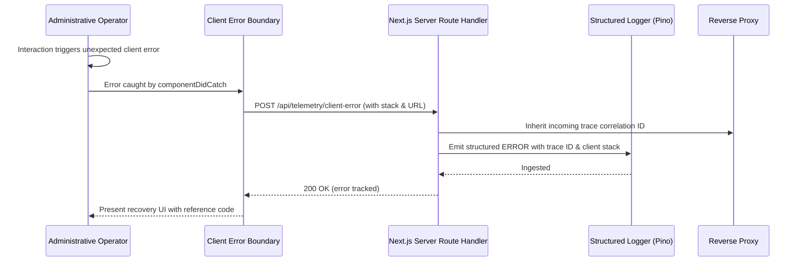

# Case Study 05: Multi-Tenant Enterprise Operations Portal with Client-to-Server Error Tracing

## 1. Overview
This case study examines the development of an enterprise web operations portal built with Next.js and TypeScript, designed to coordinate multi-department administrative workflows. The portal manages real-time transit schedules, vehicle/fleet assignments, cafeteria menus, dynamic homepage banners, and official institutional announcements under strict department-level access control.

## 2. Context and Problem
Managing distributed organization-wide services involves multiple autonomous operational departments (e.g., transit dispatchers, communications staff, catering managers). Early operations suffered from cross-department permission bleed, where staff from one department could inadvertently modify or unpublish another department's notices. Additionally, unhandled frontend exceptions in operator browsers produced no server-side telemetry, making production UI debugging impossible without direct operator interviews.

```mermaid
graph TD
    Admin["Department Administrator"]
    UI["Next.js Operations Portal (React / TS)"]
    ErrorBoundary["Client Error Boundary"]
    ServerLogger["Structured Server Logger"]
    RBAC["Department-Scoped Authorization Gate"]
    API["Microservices Gateway (Reverse Proxy)"]

    Admin --> UI
    UI -->|Uncaught React Exception| ErrorBoundary
    ErrorBoundary -->|Pushes Crash Stack + Trace ID| ServerLogger
    UI -->|Actions (News, Banners, Fleet)| RBAC
    RBAC -->|Enforces Department Scope| API
    API -->|Propagates Trace Correlation ID| ServerLogger
```

## 3. My Contributions
- **Built End-to-End Client-to-Server Distributed Error Tracing:** Integrated React client error boundaries with the server-side structured logger, capturing unhandled UI exceptions, component stack traces, and propagating correlation headers received from the reverse proxy directly into server logs (`onRequestError`).
- **Implemented Department-Scoped Access Control:** Engineered validation guards restricting content publication and transit alert authoring to authorized departmental units (`owner.department`), preventing cross-department data overwrites.
- **Developed Drag-and-Drop Banner Sequencing:** Created an interactive drag-and-drop UI component allowing administrators to visually re-sequence portal announcement banners with immediate preview and atomic database updates.
- **Engineered Tailored Skeleton Loading Architecture:** Replaced generic spinners with bespoke skeleton screens precisely mirroring the layout geometry across 6 core views (Roles, Admins, News, Fleet, Dining, and Notices), eliminating cumulative layout shifts (CLS).
- **Automated Expired Session Purging:** Authored scheduled backend maintenance scripts to purge expired refresh tokens, keeping session tables lean and secure.
- **Automated CI/CD with Self-Signed Certificate Handling:** Configured GitHub Actions pipelines that build OCI images, push to GHCR, and trigger automated redeploy webhooks on internal deployment orchestrators supporting self-signed TLS certificates.

## 4. Technical Architecture
The system architecture bridges client-side React rendering with server-side tracing and token governance:



## 5. Technology Stack
- **Framework:** Next.js (App Router / Pages), React, TypeScript.
- **Styling & Components:** Tailwind CSS, custom design system, drag-and-drop primitives.
- **Observability:** Pino, Next.js instrumentation (`onRequestError`), correlation tracing.
- **Testing & Tooling:** Playwright E2E testing, ESLint, Prettier.
- **Deployment:** Docker, GitHub Actions, GHCR, container redeployment webhooks.

## 6. Engineering Challenges
### 1. Inability to Debug Client-Side Crashes in Production
*Problem:* Operators encountered occasional rendering failures in specific browser environments, but since the errors occurred client-side, backend server logs showed no trace of the failure.
*Solution:* Wired the top-level React Error Boundary to a dedicated telemetry endpoint. The endpoint captures the error stack, component tree hierarchy, and browser user agent, tags it with the active session's correlation ID, and logs it directly into the server's structured logging pipeline.

### 2. Layout Shift and Race Conditions in Table Skeletons
*Problem:* Initial generic loading indicators caused jarring page layout shifts when transitioning from loading to populated state, occasionally triggering race conditions in Playwright E2E test runs.
*Solution:* Engineered dedicated skeleton components matching the exact height, padding, and column counts of each view, and coordinated state transitions to eliminate UI jumping and resolve Playwright test runner races.

## 7. Engineering Practices
- **Strict Role-Based Integrity:** Every mutation operation validates departmental ownership at the API boundary, guaranteeing that one administrative unit cannot delete or edit another department's notices.
- **Automated E2E Test Coverage:** Built Playwright E2E suites covering complex administrative interactions including transit alert creation, driver scheduling, and multi-select batch actions.
- **Staging and Production Isolation:** Maintained rigorous configuration segregation between staging and production environments, documenting environment contracts across the team.

## 8. Results and Impact
- **147 verified commits** establishing the operations portal, observability hooks, layout systems, and deployment workflows.
- Successful management of daily transit announcements and organizational news across multiple administrative units.
- Elimination of blind spots in production frontend monitoring through automated error boundary reporting.

## 9. My Role
Lead Frontend and Operations Architect for the portal. Responsible for the UI architecture, client-side observability integration, department-level authorization logic, and CI/CD pipelines.
