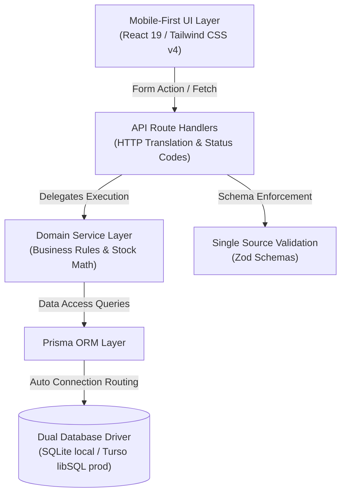
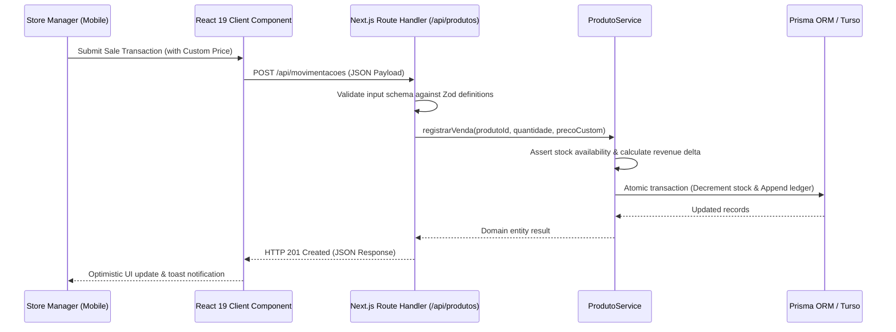

# Case Study 11: Strict Layered Architecture Inventory Management & Revenue Platform

## 1. Overview
This case study details the development of a mobile-first commercial inventory management and sales analytics platform built with Next.js 15 (App Router), React 19, TypeScript, and Prisma ORM. Engineered with a strict four-tier decoupled architecture, the system coordinates catalog management, custom pricing adjustments, transaction histories, and monthly revenue analytics dashboards.

## 2. Context and Problem
Small-to-medium retail operations frequently rely on manual paper logs or unstructured spreadsheets, resulting in stock discrepancies, lost sales history, and zero visibility into seasonal purchasing trends. Off-the-shelf enterprise ERPs are overly complex and fail on mobile devices in retail floor environments. The goal was to build a fast, mobile-first inventory application with strict separation of concerns, comprehensive input validation, and transparent zero-downtime database driver switching between local development and edge production.

## 3. My Contributions
- **Architected Strict Four-Tier Layered Architecture:** Enforced clean separation of responsibilities (`UI` → `API Handlers` → `Domain Services` → `Prisma ORM`), guaranteeing that business logic is completely isolated from HTTP presentation concerns.
- **Engineered Dual-Mode Database Connectivity:** Configured dynamic connection switching inside the Prisma client: connecting seamlessly to local SQLite (`dev.db`) during offline development, and auto-switching to Turso (libSQL) when production environment variables are present.
- **Built Interactive Revenue & Sales Dashboards:** Designed visual monthly revenue charts and category performance metrics, addressing subtle CSS rendering issues (such as bar height overflows) on high-density mobile displays.
- **Implemented Flexible Transaction Processing:** Added support for dynamic price overrides during point-of-sale transactions and individual ledger record deletions with inventory quantity rollbacks.
- **Authored Comprehensive Technical Specifications:** Documented the entire domain model, business rules, API contracts, and deployment guides in a dedicated `specs/` repository structure.

## 4. Technical Architecture
The application separates concerns across four distinct architectural tiers:

## 5. Technology Stack
- **Framework & Runtime:** Next.js 15 (App Router), React 19, TypeScript (strict mode).
- **Styling:** Tailwind CSS v4 (mobile-first design).
- **Persistence:** Prisma ORM, SQLite (local development), Turso / libSQL (production).
- **Validation:** Zod (unified contract enforcement).

## 6. Engineering Challenges
### 1. Zero-Friction Database Switching Between Local and Production
*Problem:* Developers needed to test database migrations and mutations offline without requiring live cloud credentials, while production required an edge-distributed libSQL database.
*Solution:* Built an automatic runtime connection factory in `lib/prisma.ts`. The adapter inspects the environment: if `TURSO_DATABASE_URL` is set, it initializes the libSQL driver; otherwise, it seamlessly attaches to local SQLite, requiring zero code modifications across environments.

### 2. Bar Chart Clipping on Mobile Viewports
*Problem:* In the initial sales dashboard, variable revenue spikes caused monthly bars to overflow their container boundaries and clip category labels on small mobile screens.
*Solution:* Refactored the chart calculation engine to compute relative proportions based on dynamic maximum monthly revenue baselines, adding responsive container padding and scalable CSS grid layouts.

## 7. Engineering Practices
- **Single Source of Validation Truth:** All input shapes, query parameters, and database mutations are strictly defined using Zod schemas in `server/validation.ts`, serving as the single source of truth for both client forms and server routes.
- **Domain-Driven Error Translation:** Created dedicated domain error classes (`server/errors.ts`) that cleanly decouple internal application exceptions from HTTP status codes.
- **Comprehensive Architectural Documentation:** Maintained living specification documents in `specs/` covering architecture, data models, and extension patterns.

## 8. Results and Impact
- **7 verified commits** establishing the complete application, layered architecture, analytics dashboards, and domain specifications.
- Flawless multi-environment operation across local SQLite and cloud Turso environments.
- Mobile-first stock management and sales reporting utilized directly in retail operations.

## 9. My Role
Sole Full-Stack Architect and Developer. Designed the database schemas, built the four-tier backend services, developed the React UI, and authored the technical specifications.
