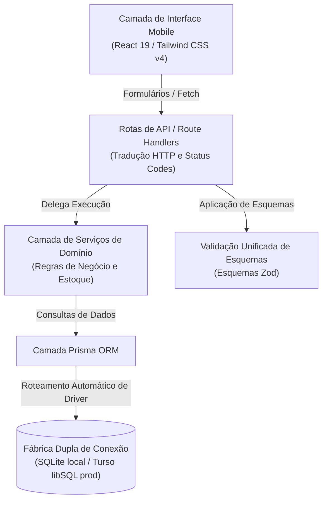
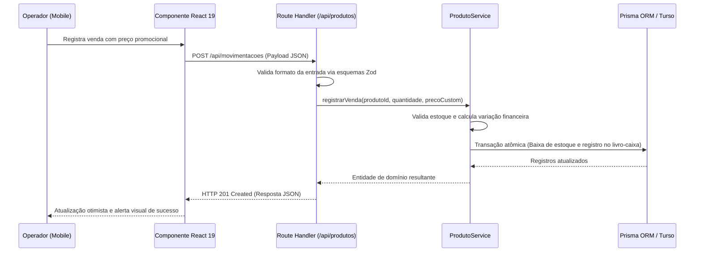

# Estudo de Caso 11: Plataforma Comercial com Arquitetura em Camadas e Análise de Faturamento

  
  
  
  
  
  

## 1. Visão Geral
Este estudo de caso aborda o desenvolvimento de uma plataforma de gestão de estoque e análise de vendas voltada para dispositivos móveis, construída com Next.js 15 (App Router), React 19, TypeScript e Prisma ORM. Projetado sob uma arquitetura limpa em quatro camadas desacopladas, o sistema centraliza o controle de catálogo, ajustes flexíveis de preços, histórico de transações e painéis com métricas mensais de faturamento.

## 2. Contexto e Problema
Operações comerciais de pequeno e médio porte frequentemente gerenciam estoques por meio de fichas manuais ou planilhas desorganizadas, resultando em divergências de mercadorias, perda do histórico de vendas e falta de clareza sobre sazonalidades. Softwares corporativos legados costumam ser excessivamente complexos e incompatíveis com telas de celulares no ambiente de vendas. O objetivo foi criar uma aplicação rápida, pensada prioritariamente para uso mobile, com isolamento estrito de responsabilidades, validação rigorosa de entradas e alternância transparente de banco de dados entre desenvolvimento local e produção em nuvem.

## 3. Minhas Contribuições
- **Modelagem da Arquitetura em Quatro Camadas:** Apliquei separação clara de responsabilidades (`UI` → `API Handlers` → `Serviços de Domínio` → `Prisma ORM`), garantindo que regras de negócio permaneçam totalmente isoladas dos controladores de rede.
- **Fábrica de Conexão Dupla de Banco de Dados:** Configurei a alternância dinâmica de driver no Prisma: operando em SQLite local (`dev.db`) em desenvolvimento offline e ativando Turso (libSQL) em nuvem quando as credenciais de produção estão presentes.
- **Painéis Interativos de Vendas e Faturamento:** Construí gráficos mensais de receita e indicadores de vendas por categoria, corrigindo limitações visuais de barras em telas de celulares de alta densidade.
- **Processamento Flexível de Vendas e Baixas de Estoque:** Implementei suporte a preços ajustados no ponto de venda e rotina segura de cancelamento de movimentações com devolução automática de produtos ao estoque.
- **Documentação de Especificações Técnicas:** Elaborei especificações formais descrevendo o modelo de dados, as regras operacionais, os contratos de API e os guias de publicação no diretório `specs/`.

## 4. Arquitetura Técnica
A aplicação distribui as responsabilidades entre quatro níveis estruturais:

## 5. Stack Tecnológica
- **Framework e Ambiente:** Next.js 15 (App Router), React 19, TypeScript (modo estrito).
- **Estilização:** Tailwind CSS v4 (design responsivo priorizando mobile).
- **Persistência de Dados:** Prisma ORM, SQLite (desenvolvimento local), Turso / libSQL (produção).
- **Validação de Dados:** Zod (contratos de validação unificados).

## 6. Desafios de Engenharia
### 1. Alternância de Banco de Dados sem Fricção
*Problema:* Desenvolvedores precisavam validar migrações e persistência de dados localmente sem conexão constante com a nuvem, enquanto o ambiente de produção exigia uma base libSQL distribuída.
*Solução:* Construí uma fábrica de conexões em `lib/prisma.ts`. O módulo analisa o ambiente: havendo `TURSO_DATABASE_URL`, ativa o driver da nuvem libSQL; caso contrário, conecta-se ao arquivo SQLite local, sem necessidade de alterações no código.

### 2. Corte de Barras em Gráficos em Telas Pequenas
*Problema:* Em telas reduzidas de celulares, oscilações no volume mensal de faturamento faziam com que as barras do gráfico ultrapassassem o limite dos contêineres e cortassem rótulos de valores.
*Solução:* Reformulei a lógica de renderização para calcular alturas proporcionais baseadas no maior faturamento registrado, aplicando espaçamentos responsivos e grades escaláveis em CSS.

## 7. Práticas de Engenharia
- **Fonte Única para Validações:** Todos os formatos de entrada, filtros de consulta e mutações de banco são centralizados em esquemas Zod em `server/validation.ts`, servindo de referência para formulários e rotas de API.
- **Tratamento Semântico de Exceções:** Criação de classes de erro de domínio em `server/errors.ts` que separam falhas de regras de negócio dos códigos de retorno HTTP.
- **Especificações de Arquitetura Vivas:** Manutenção de documentos técnicos atualizados em `specs/` abordando modelagem de dados, regras de negócio e fluxos de extensão.

## 8. Resultados e Impacto
- **7 commits verificados** estabelecendo o projeto completo, camadas desacopladas, gráficos de faturamento e especificações formais.
- Execução consistente em SQLite local e na nuvem do Turso.
- Ferramenta funcional de controle de produtos e vendas utilizada diretamente na rotina operacional do comércio.

## 9. Meu Papel
Arquiteto Full-Stack e Desenvolvedor Único. Modelei as entidades de banco, programei os serviços de domínio em quatro camadas, criei a interface mobile em React e elaborei as especificações técnicas.
