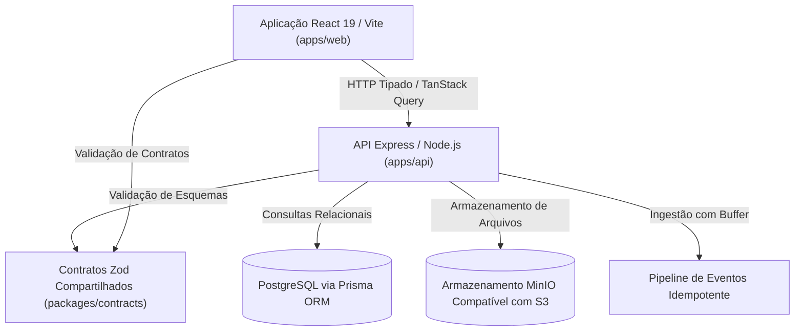
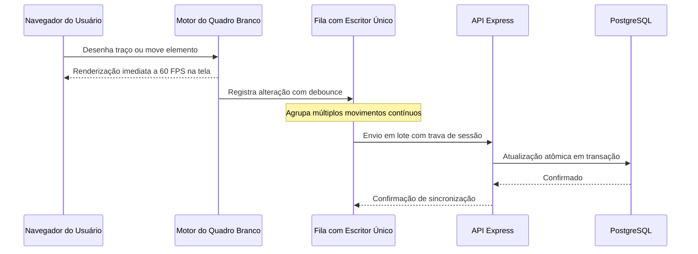

# Estudo de Caso 01: Motor Gráfico de Matrizes Curriculares e Quadro Branco Colaborativo

## 1. Visão Geral
Este estudo de caso aborda a engenharia de uma plataforma educacional de planejamento acadêmico, projetada para representar matrizes curriculares do ensino superior como grafos acíclicos dirigidos (DAGs) interativos, complementada por um quadro branco colaborativo infinito para planejamento visual de estudos. Desenvolvido como um monorepo TypeScript com npm workspaces, o sistema integra uma API em Express e Prisma de alta capacidade a um cliente responsivo em React 19 e Vite.

## 2. Contexto e Problema
Grades curriculares universitárias frequentemente apresentam regras complexas de dependência onde pré-requisitos, correquisitos e linhas de formação geram sobrecarga de planejamento para os estudantes. Portais acadêmicos convencionais exibem essas informações apenas como tabelas estáticas, dificultando a visualização de trajetórias, gerando atrasos em formaturas e dúvidas de matrícula. O desafio foi converter matrizes curriculares densas em uma ferramenta visual interativa e fluida para computadores e dispositivos móveis.

## 3. Minhas Contribuições
- **Engenharia de Pipeline de Eventos Analíticos Idempotente:** Projetei e programei o serviço de coleta de eventos (`ingestion.service.ts`), capaz de processar fluxos de telemetria com deduplicação, travas atômicas no banco de dados e relatórios de retenção de coortes.
- **Arquitetura da Fila de Persistência do Quadro Branco:** Criei uma fila write-behind com escritor único que desacopla os traços desenhados na tela da persistência no banco, garantindo resposta imediata sem atrasos na renderização e mantendo a consistência via verificações periódicas.
- **Otimização Gráfica do Fluxograma de Disciplinas:** Identifiquei gargalos de desempenho e refatorei o componente de grafo da grade, ajustando a estrutura de memoização no React e simplificando sombras e filtros CSS pesados em celulares para sustentar 60 FPS constantes.
- **Modelagem de Matrizes Curriculares de Engenharia:** Estruturei matrizes completas de cursos universitários em esquemas YAML fortemente tipados, registrando códigos de disciplina, cargas horárias, pré-requisitos e correquisitos.
- **Automação de CI/CD com Assinatura Criptográfica:** Configurei esteiras no GitHub Actions com assinatura de imagens de contêineres via Sigstore Cosign, análise de vulnerabilidades com Trivy e deploy em servidores VPS de produção.

## 4. Arquitetura Técnica
O sistema utiliza organização em monorepo com separação nítida entre interface, regras de negócio e contratos de validação:

## 5. Stack Tecnológica
- **Backend:** Node.js, TypeScript, Express.js, Prisma ORM, PostgreSQL, Zod, Pino.
- **Frontend:** React 19, Vite, Tailwind CSS, shadcn/ui, TanStack Query, Zustand.
- **Armazenamento e Nuvem:** MinIO (compatível com S3), Docker, Docker Compose.
- **Segurança e DevOps:** GitHub Actions, Cosign (assinatura digital de imagens), Trivy (varredura de falhas), GHCR.

## 6. Desafios de Engenharia
### 1. Queda de Quadros Durante Desenhos Rápidos no Quadro Branco
*Problema:* Versões iniciais disparavam gravações no banco e geração de miniaturas a cada evento de movimento do ponteiro, gerando travamentos visíveis e perda de fluidez durante desenhos livres.
*Solução:* Implementei uma fila assíncrona com escritor único que agrupa e adia gravações durante o desenho contínuo, memoizei a geração de traços e posterguei a criação de miniaturas para momentos ociosos do navegador com `requestIdleCallback`.

### 2. Ingestão Concorrente de Eventos Analíticos em Horários de Pico
*Problema:* Acessos simultâneos de alunos geravam condições de corrida nas tabelas de métricas, causando contagens incorretas e duplicação de dados de engajamento.
*Solução:* Estruturei uma arquitetura idempotente para ingestão de eventos, aplicando hashes únicos para cada ação, transações com travas de linha no banco e agrupamento em lotes para garantir processamento exato.

## 7. Práticas de Engenharia
- **Contratos no Monorepo como Referência Central:** Todos os esquemas de validação de requisições, respostas e enums residem em `packages/contracts` via Zod, sendo compartilhados diretamente entre a API e a interface web.
- **Segurança da Cadeia de Suprimentos de Software:** Imagens de contêiner para produção são assinadas digitalmente com Cosign durante a esteira de CI, garantindo que apenas pacotes verificados executem em produção.
- **Interface com Desempenho Adaptativo:** Efeitos visuais e contornos brilhantes são desativados automaticamente em dispositivos móveis com processadores gráficos mais simples.

## 8. Resultados e Impacto
- Mais de **190 commits verificados** estabelecendo a base da plataforma, o motor curricular, o quadro colaborativo e o pipeline analítico.
- Matriz completa de Engenharia de Computação modelada e validada com verificação automática de encadeamento de requisitos.
- Ausência de atrasos perceptíveis no desenho, operando dentro do orçamento de 16 ms por quadro em computadores comuns.

## 9. Meu Papel
Arquiteto Principal e Desenvolvedor Full-Stack Líder. Responsável pela configuração do monorepo, modelagem do banco de dados, fila de sincronização do quadro branco, módulo analítico e automações de CI/CD.
