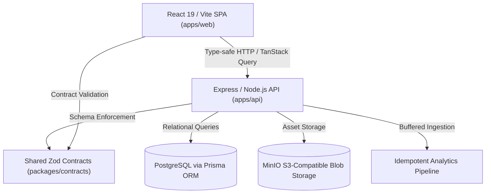
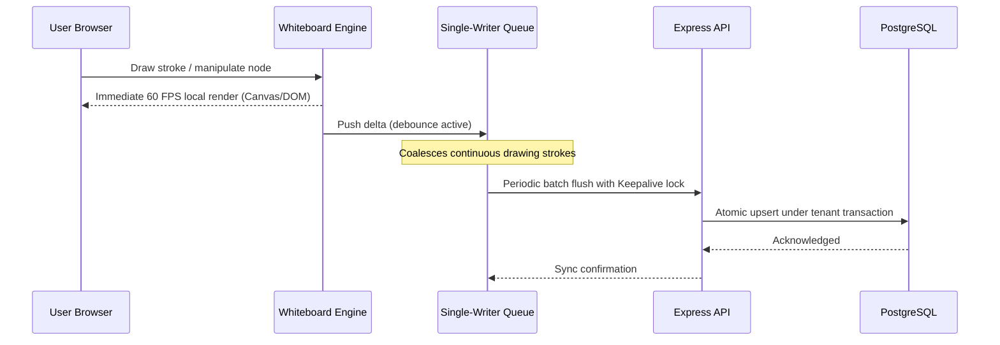

# Case Study 01: Interactive Degree Curriculum Graph Engine & Collaborative Whiteboard

## 1. Overview
This case study examines the engineering of a full-stack educational planning platform built to model higher-education degree curricula as reactive directed acyclic graphs (DAGs), complemented by an infinite collaborative whiteboard for visual study scheduling. Architected as a TypeScript monorepo using npm workspaces, the system pairs a high-throughput Express/Prisma API with a responsive React 19 / Vite client.

## 2. Context and Problem
Academic degree programs often incorporate multi-level dependency structures where prerequisite courses, corequisites, and advisory tracks introduce substantial cognitive overhead for students. Standard enterprise university portals present academic records as static flat tables, resulting in planning ambiguity, scheduling bottlenecks, and delayed graduations. The objective was to transform complex tabular academic catalogs into an interactive graph-based planning application capable of fluid exploration on mobile and desktop devices.

## 3. My Contributions
- **Engineered an Idempotent Analytics Pipeline:** Designed and implemented an event ingestion service (`ingestion.service.ts`) capable of processing telemetry streams with deduplication, database ingestion locks, and retention cohort aggregation.
- **Architected the Collaborative Whiteboard Persistence Queue:** Developed a single-writer write-behind queue for the whiteboard tool, decoupling stroke rendering from database persistence, ensuring zero input latency while maintaining data integrity via keepalive conflict checks.
- **Optimized the Curriculum Flowchart Graph Rendering:** Profiled and refactored the interactive curriculum graph component, correcting broken memoization trees and flattening heavy CSS glow filters on mobile and tablet devices to achieve steady 60 FPS transitions.
- **Modeled Complex Engineering Curricula:** Codified full university degree catalogs into strongly typed YAML schemas, incorporating course identifiers, credit hours, prerequisites, and corequisite dependency rules.
- **Hardened Container Security & CI/CD Pipelines:** Implemented automated GitHub Actions workflows with container image signing via Sigstore Cosign, vulnerability auditing via Trivy, and automated deployment to production VPS environments.

## 4. Technical Architecture
The system employs a strict monorepo layout split between presentation, domain logic, and shared contracts:

## 5. Technology Stack
- **Backend:** Node.js, TypeScript, Express.js, Prisma ORM, PostgreSQL, Zod, Pino.
- **Frontend:** React 19, Vite, Tailwind CSS, shadcn/ui, TanStack Query, Zustand.
- **Storage & Infrastructure:** MinIO (S3-compatible blob storage), Docker, Docker Compose.
- **DevSecOps:** GitHub Actions, Cosign (image signing), Trivy (vulnerability scanning), GHCR.

## 6. Engineering Challenges
### 1. Canvas Freezes During Fast Freehand Drawing
*Problem:* Initial iterations triggered database save calls and thumbnail generation on every pointer movement event, creating micro-stutters and frame drops during freehand drawing.
*Solution:* Implemented an asynchronous single-writer queue that suppresses save triggers during active pointer movement, memoized the canvas stroke generation engine, and deferred thumbnail rasterization to idle browser callbacks using `requestIdleCallback`.

### 2. High-Frequency Analytics Ingestion Under Concurrent Traffic
*Problem:* Telemetry events triggered race conditions when students updated study plans simultaneously, producing skewed engagement counts and duplicate metric increments.
*Solution:* Established an idempotent event ingestion architecture enforcing unique event hashing, transactional database row locks, and batching to guarantee exactly-once processing semantics.

## 7. Engineering Practices
- **Monorepo Contracts as Single Source of Truth:** All API request/response envelopes, enums, and domain validation schemas are centrally defined in `packages/contracts` using Zod and imported across both backend and frontend layers.
- **Cryptographic Supply Chain Security:** Container images built for production are cryptographically signed using Cosign during CI, ensuring that only verified binaries run in production.
- **Accessibility & Device Adaptive Rendering:** Visual indicators and glowing effects dynamically collapse into solid high-contrast borders on low-power mobile GPUs.

## 8. Results and Impact
- Over **190 verified commits** establishing the core architecture, curriculum engine, whiteboard tool, and analytics pipeline.
- Complete digitized curriculum dependency tree for Computer Engineering with automated validation of prerequisite chains.
- Elimination of drawing latency, supporting sub-16ms frame budgets on standard browser hardware.

## 9. My Role
Lead Architect and Core Full-Stack Developer for the platform, responsible for monorepo configuration, backend database schemas, whiteboard queue mechanics, analytics engine, and CI/CD automation.
