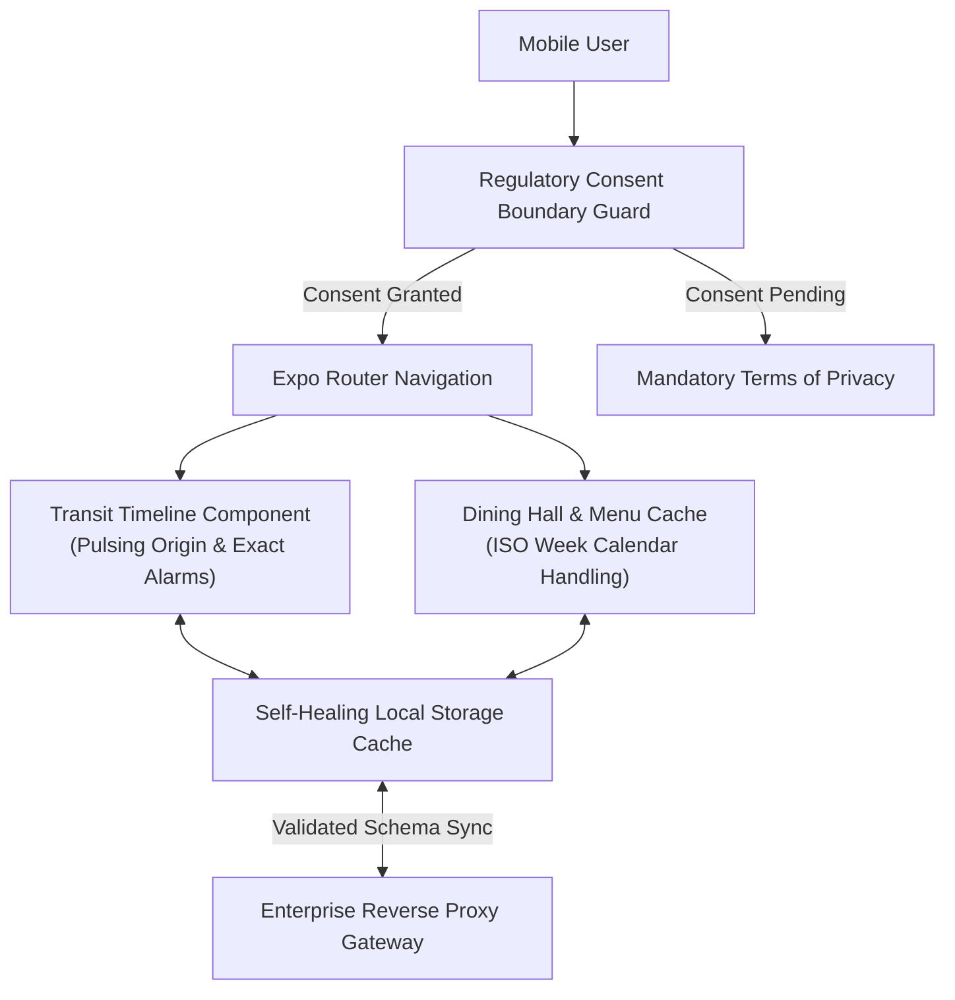
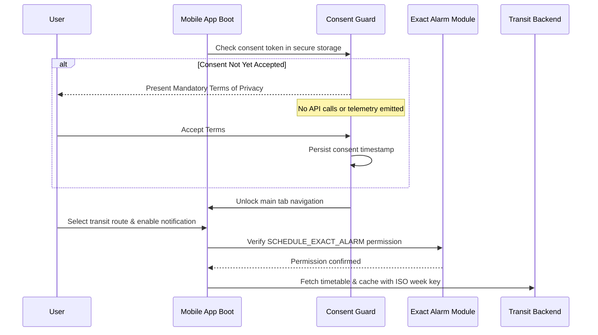

# Case Study 04: Real-Time Fleet Transit Navigation & Privacy-Preserving Mobile Application

## 1. Overview
This case study covers the frontend and mobile architecture of a production cross-platform application developed with React Native and Expo for thousands of daily active users. The application serves as an institutional mobility and services super-app, consolidating real-time shuttle fleet tracking, route stop timelines, cafeteria meal schedules, news feeds, and personalized schedule alerts.

## 2. Context and Problem
The host organization operates a geographically distributed multi-campus network across several municipalities, relying on scheduled shuttle fleets to transport members and staff. Users frequently experienced scheduling friction, missed connections, and unannounced traffic reroutes due to a lack of live digital tracking. Furthermore, strict statutory privacy requirements demanded that user telemetry, identifier exchange, and background network queries remain completely halted until explicit informed consent is recorded.

## 3. My Contributions
- **Engineered an Accessible Bus Stop Timeline UI:** Designed and developed a custom single-stroke SVG/Canvas transit timeline featuring an animated pulsating origin stop indicator, engineered with reactive support for system-level reduced motion preferences (`prefers-reduced-motion`).
- **Implemented an Android Exact Alarm Permission Module:** Developed native bridge integration to inspect and request exact alarm scheduling permissions on modern Android versions, ensuring transit reminder notifications fire with exact wall-clock timing.
- **Architected a Strict Consent Barrier:** Built a routing middleware that intercepts application boot, blocking any background data processing, telemetry logging, or API token exchange until the user explicitly accepts privacy terms.
- **Developed a Self-Healing Offline Cache:** Created resilient storage logic on top of AsyncStorage that validates incoming API payloads, self-heals corrupted cache structures, and handles ISO week boundaries for meal menus.
- **Streamlined CI/CD & Over-The-Air (OTA) Updates:** Configured automated linting, type-checking, and Jest testing pipelines on push and PR, along with Expo EAS over-the-air update capabilities.

## 4. Technical Architecture
The client architecture enforces a clean separation between UI components, custom hooks, and offline storage:

## 5. Technology Stack
- **Framework:** React Native, Expo, Expo Router.
- **Styling & Design System:** Tailwind CSS via NativeWind, custom SVG icons.
- **State & Storage:** React Hooks, AsyncStorage, custom self-healing cache wrappers.
- **Native Modules:** Android Exact Alarm native bridge integration.
- **Testing & Quality:** Jest, React Native Testing Library, ESLint, Prettier.

## 6. Engineering Challenges
### 1. Battery Drain and Animation Jank on Transit Timelines
*Problem:* Continuous looping pulse animations on transit origin stops caused excessive battery consumption and visual jank on lower-end Android hardware, and caused discomfort for users with vestibular sensitivities.
*Solution:* Implemented an interaction-aware animation hook that pauses rendering when the transit tab is out of focus, hooks into `InteractionManager` during transitions, and immediately collapses into a static high-contrast marker when the OS `reduce motion` setting is active.

### 2. Silent Notification Failures on Android 12+
*Problem:* Battery-saving restrictions in Android 12 and above delayed or canceled transit reminder notifications when scheduled via standard notification APIs.
*Solution:* Integrated explicit checks for the `SCHEDULE_EXACT_ALARM` permission, directing users to system authorization screens when necessary and gracefully falling back to inexact interval notifications if declined.

## 7. Engineering Practices
- **Privacy by Design:** Strict technical enforcement ensuring that unauthenticated or unconsented app states never ping backend telemetry endpoints.
- **Resilient Mobile Caching:** Payloads fetched from the network are validated against runtime schemas before persisting, preventing corrupt API responses from bricking local state.
- **Comprehensive Mobile Testing:** Maintained unit and integration tests covering debounce utilities, schedule calculations, and notification trigger handlers.

## 8. Results and Impact
- **133 verified commits** driving the transit interface, privacy consent boundary, native alarm permissions, and release stabilization.
- Delivered a stable daily mobile tool utilized across a distributed institutional network.
- 100% compliance with privacy regulatory standards and zero battery-drain complaints related to transit UI animations.

## 9. My Role
Core Mobile Engineer and Frontend Architect. Collaborated with peer mobile developers, owning the transit feature architecture, exact alarm native integration, security gates, and release testing pipelines.
