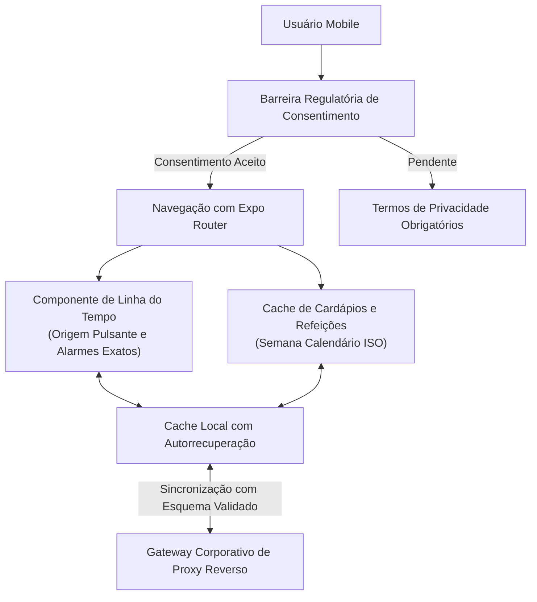
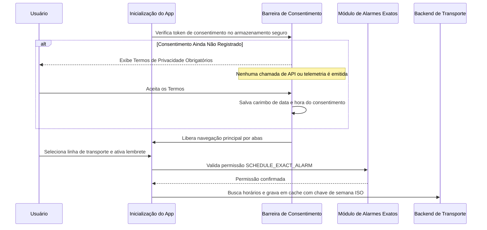

# Estudo de Caso 04: Aplicativo Mobile de Rastreamento de Frotas com Preservação de Privacidade

## 1. Visão Geral
Este estudo de caso abrange a arquitetura frontend e mobile de uma aplicação multiplataforma em produção desenvolvida com React Native e Expo para milhares de usuários ativos diários. O aplicativo funciona como uma plataforma integrada de mobilidade e serviços institucionais, reunindo rastreamento de frotas de transporte em tempo real, linhas do tempo de paradas, cardápios de restaurantes universitários, feeds de notícias e lembretes de horários personalizados.

## 2. Contexto e Problema
A instituição opera uma rede geograficamente distribuída de múltiplos campi em diferentes municípios, dependendo de frotas de ônibus circulares para o transporte de alunos e servidores. Usuários enfrentavam constantes desencontros de horários, perda de viagens e alterações imprevistas de rotas devido à ausência de rastreamento digital. Além disso, exigências regulatórias rigorosas de privacidade exigiam que qualquer coleta de telemetria, troca de identificadores e consultas de rede em segundo plano ficassem totalmente bloqueadas até que o consentimento formal do usuário fosse registrado.

## 3. Minhas Contribuições
- **Desenvolvimento da Linha do Tempo de Transporte Acessível:** Projetei e programei uma linha do tempo vetorial em SVG com indicador pulsante animado na parada de origem, implementando suporte dinâmico para a preferência de redução de movimento do sistema operacional (`prefers-reduced-motion`).
- **Módulo Nativo de Alarmes Exatos no Android:** Desenvolvi a integração com o módulo nativo do Android para consultar e requisitar permissões de agendamento de alarmes exatos, assegurando que as notificações de lembrete de partida disparem precisamente no horário programado.
- **Estruturação de Barreira Rigorosa de Consentimento:** Criei um middleware de roteamento que intercepta o carregamento da aplicação, bloqueando chamadas de API, telemetria e tokens até a aceitação explícita dos termos de privacidade.
- **Cache Local com Autorrecuperação:** Desenvolvi uma camada de persistência resiliente sobre o AsyncStorage que valida dados recebidos da rede contra esquemas estritos, repara estruturas corrompidas e manipula chaves baseadas em semanas ISO para os cardápios.
- **Otimização de CI/CD e Atualizações OTA:** Configurei rotinas de validação estática de tipos, linting e testes automatizados com Jest em pull requests, além de suporte a atualizações sem necessidade de nova instalação via Expo EAS.

## 4. Arquitetura Técnica
A arquitetura do cliente separa rigorosamente componentes visuais, hooks customizados e persistência local:

## 5. Stack Tecnológica
- **Framework Mobile:** React Native, Expo, Expo Router.
- **Estilização e Design System:** Tailwind CSS via NativeWind, ícones vetoriais em SVG.
- **Estado e Armazenamento:** React Hooks, AsyncStorage, camada de cache com autorrecuperação.
- **Módulos Nativos:** Integração nativa para Alarmes Exatos no Android.
- **Testes e Qualidade:** Jest, React Native Testing Library, ESLint, Prettier.

## 6. Desafios de Engenharia
### 1. Consumo Excessivo de Bateria e Travamentos em Animações
*Problema:* Animações de pulso contínuo na linha do tempo geravam consumo desnecessário de bateria e quedas de quadros em dispositivos Android básicos, além de desconforto visual para usuários sensíveis a movimentos contínuos.
*Solução:* Implementei um hook de animação consciente do contexto que pausa o desenho quando a aba perde o foco, sincroniza com o `InteractionManager` durante transições de tela e substitui a animação por um marcador estático de alto contraste caso a redução de movimento esteja ativada no sistema.

### 2. Notificações Silenciadas pelo Modo de Economia do Android 12+
*Problema:* Otimizações de bateria em versões recentes do Android atrasavam ou cancelavam lembretes de transporte agendados via APIs comuns de notificação.
*Solução:* Adicionei validação explícita da permissão `SCHEDULE_EXACT_ALARM`, conduzindo o usuário à tela de autorização do sistema quando necessário e utilizando intervalos aproximados caso a permissão seja recusada.

## 7. Práticas de Engenharia
- **Privacidade por Concepção:** Garantia técnica de que estados não autenticados ou sem consentimento nunca façam requisições para endpoints de telemetria.
- **Persistência Móvel Segura:** Dados vindos da rede são validados contra esquemas em tempo de execução antes de serem gravados no disco local, prevenindo travamentos do aplicativo por respostas corrompidas.
- **Bateria Abrangente de Testes:** Manutenção de testes unitários e de integração cobrindo debounce, cálculos de horários e disparos de alarmes.

## 8. Resultados e Impacto
- **133 commits verificados** consolidando o módulo de transporte, barreira de privacidade, alarmes nativos e estabilização de versões.
- Ferramenta diária utilizada por milhares de membros da comunidade acadêmica em múltiplos campi.
- Conformidade total com normas de privacidade e zero relatos de consumo anômalo de bateria vinculados à interface.

## 9. Meu Papel
Engenheiro Mobile Principal e Arquiteto Frontend. Atuei em colaboração com outros desenvolvedores mobile, responsabilizando-me pela arquitetura do módulo de transporte, integração dos alarmes nativos, barreiras de segurança e pipelines de testes.
